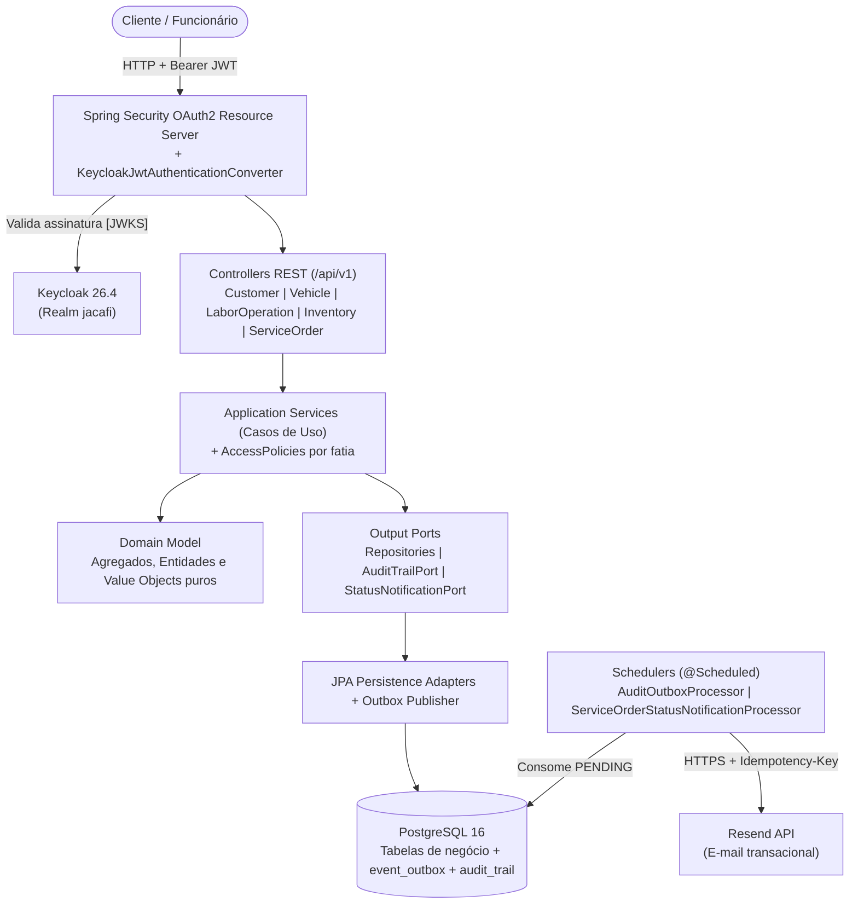
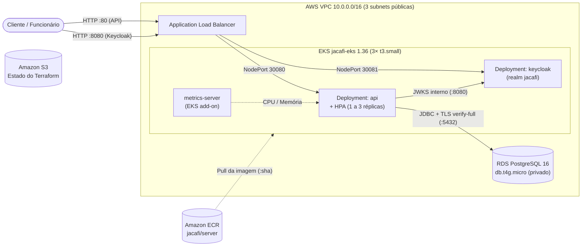
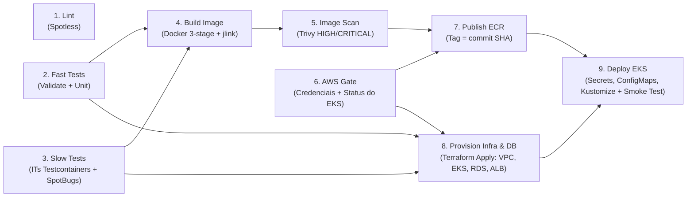

# JACAFI — Sistema de Gestão de Oficina

Back-end do Tech Challenge FIAP para gestão de clientes, veículos, catálogo de serviços (`LaborOperation`), estoque de peças e insumos e ordens de serviço (OS), com geração automática de orçamento, aprovação ou recusa pelo cliente, fila operacional priorizada, trilha de auditoria imutável e notificação de mudança de status por e-mail.

## Objetivos da Fase 2

A Fase 2 evolui a solução da Fase 1 em quatro frentes principais:

1. **Refatoração para Clean Architecture e Clean Code:** organização do monólito modular em fatias verticais ([ADR-001](docs/adr/ADR-001-vertical-slice-architecture.md)) com separação estrita entre domínio (`domain`), casos de uso e portas (`application`) e adaptadores de entrada e saída (`adapter/in`, `adapter/out`), delegação da autenticação ao Keycloak ([ADR-005](docs/adr/ADR-005-keycloak-identity-provider.md)) e uso de *Transactional Outbox* para auditoria e notificações ([ADR-004](docs/adr/ADR-004-transactional-outbox-audit-notifications.md)).
2. **Orquestração e Escalabilidade com Kubernetes ([/k8s](k8s/README.md)):** empacotamento em imagem Docker otimizada em três estágios com `jlink` ([server/Dockerfile](server/Dockerfile)) e manifestos Kustomize com *Deployments*, *Services*, *ConfigMaps*, *Secrets*, *probes* de saúde e *Horizontal Pod Autoscaler* (HPA de 1 a 3 réplicas) para ambientes local, teste de carga e AWS EKS ([ADR-007](docs/adr/ADR-007-kubernetes-kustomize-hpa.md)).
3. **Infraestrutura como Código com Terraform ([/infra](infra/README.md)):** provisionamento automatizado na AWS dividido em stack persistente (`infra/bootstrap`: S3 de estado, ECR, IAM de menor privilégio e Budget) e stack efêmero (`infra`: VPC, EKS 1.36, RDS PostgreSQL 16 privado e Application Load Balancer) ([ADR-006](docs/adr/ADR-006-ephemeral-aws-eks-two-stack-terraform.md)).
4. **Entrega Contínua (CI/CD) ([.github/workflows](.github/workflows/ci.yaml)):** esteira automatizada no GitHub Actions cobrindo lint, testes unitários e de integração (Testcontainers), SAST (SpotBugs/FindSecBugs), build da imagem, varredura de vulnerabilidades (Trivy), publicação no ECR, `terraform apply` da infraestrutura e do banco, deploy no EKS e *smoke test* pelo ALB, acompanhada do workflow de destruição automática ([infra-destroy.yaml](.github/workflows/infra-destroy.yaml)).

## Vídeo Demonstrativo e Collection das APIs

- **Collection completa da API (Postman v2.1):** [docs/api/jacafi.postman_collection.json](docs/api/jacafi.postman_collection.json) — guia de importação, variáveis e catálogo completo de endpoints em [docs/api/README.md](docs/api/README.md).
- **Especificação OpenAPI / Swagger UI:** disponível em `/swagger-ui/index.html` e `/v3/api-docs` (local em `http://localhost:8082/swagger-ui/index.html` e no EKS em `http://<alb_dns>/swagger-ui/index.html`).
- **Script de teste de carga (HPA):** [k8s/load-test.k6.js](k8s/load-test.k6.js) — instruções de execução e métricas em [k8s/README.md](k8s/README.md#carga-local-isolada-com-nodeport).
- **Vídeo demonstrativo (YouTube / Vimeo — até 15 min):** *(inserir link público ou não listado do vídeo demonstrando o pipeline CI/CD, o deploy no EKS, o consumo das APIs e o escalonamento automático com HPA)*.

## Arquitetura

### 1. Componentes da Aplicação

O projeto é um monólito modular organizado por fatias verticais. Cada fatia aplica Clean Architecture: o domínio não depende de Spring, JPA ou HTTP; a aplicação expõe casos de uso e portas; os adaptadores implementam web, persistência e notificações.

```text
com.jacafi.tech/<slice>/
├── domain/       # regras, agregados, entidades e objetos de valor
├── application/  # casos de uso, políticas de acesso e portas
├── adapter/in/   # API REST, DTOs, controllers e schedulers
├── adapter/out/  # JPA, repositórios e integrações externas (Resend)
└── config/       # composição de beans da fatia
```

Fatias atuais: `customer`, `vehicle`, `inventory`, `laboroperation` e `serviceorder`. Itens compartilhados (`shared`) são limitados a preocupações transversais: segurança, auditoria, outbox, erros, paginação e tempo. A autenticação fica no Keycloak, e a aplicação atua como *resource server* OAuth2 validando o JWT (ver [ADR-005](docs/adr/ADR-005-keycloak-identity-provider.md)).



As decisões arquiteturais estão em [docs/adr](docs/adr) (`ADR-001` a `ADR-007`), os termos do domínio em [docs/linguagem-ubiqua.md](docs/linguagem-ubiqua.md), os fluxos em [docs/event-storming.md](docs/event-storming.md), as visões C4 em [docs/c4-model.md](docs/c4-model.md) e o retrato detalhado em [docs/arquitetura.md](docs/arquitetura.md).

### 2. Infraestrutura Provisionada (AWS + Kubernetes)



### 3. Fluxo de Deploy (CI/CD)



## Execução local

Pré-requisitos: Docker e Docker Compose. Para executar fora do container, use Java 25 e Maven 3.9+.

Para Kubernetes, siga [k8s/README.md](k8s/README.md): execução no Docker Desktop, teste de carga isolado e preparação para AWS EKS. O guia inclui Secrets, autenticação, pré-requisitos de infraestrutura e o bloqueio de concorrência da outbox antes de liberar múltiplas réplicas com escritas.

```powershell
docker compose --env-file .env.example up -d --build
```

O Compose sobe PostgreSQL, Keycloak e a API. O Keycloak importa o realm versionado em [keycloak/jacafi-realm.json](keycloak/jacafi-realm.json) na subida; o banco dele não é persistido, então o arquivo é a única fonte da verdade do realm local. Os serviços ficam disponíveis em:

| Recurso | Endereço |
|---|---|
| API | `http://localhost:8082` |
| Keycloak | `http://localhost:8081` |
| Swagger UI | `http://localhost:8082/swagger-ui/index.html` |
| OpenAPI | `http://localhost:8082/v3/api-docs` |
| Liveness | `http://localhost:8082/actuator/health/liveness` |
| Readiness | `http://localhost:8082/actuator/health/readiness` |

`APP_PORT`, `DATABASE_PORT` e `KEYCLOAK_PORT` permitem alterar somente as portas expostas no host; `SERVER_PORT` mantém a porta interna da aplicação. O Compose aguarda a saúde do PostgreSQL e do Keycloak antes de iniciar a API e verifica a prontidão da aplicação.

`KEYCLOAK_ISSUER_URI` é o endereço público do realm, usado para validar o claim `iss` do token; `KEYCLOAK_JWK_SET_URI` é o endereço interno da rede do Compose, usado para obter as chaves de assinatura. Os dois são distintos de propósito, porque o navegador e a API alcançam o Keycloak por endereços diferentes.

### Imagem da API

O [Dockerfile](server/Dockerfile) tem três estágios: `build` compila com Maven e extrai as camadas do Spring Boot; `jre` gera com `jlink` um runtime Java só com os módulos do JDK que a aplicação usa; o estágio final, sobre Alpine, recebe apenas esse runtime e as camadas da aplicação e executa com o usuário sem privilégio `app` (UID 10001). A imagem não declara variáveis de configuração: todas chegam pelo Compose. Testes, Spotless, Checkstyle e Enforcer não rodam no build da imagem; ficam no `mvn verify`.

As decisões de desempenho e segurança, a varredura de vulnerabilidades e a manutenção da lista de módulos do `jlink` estão em [docs/cicd/imagem-docker.md](docs/cicd/imagem-docker.md).

## Infraestrutura na AWS e CI/CD

O Terraform em [infra/](infra/README.md) provisiona o ambiente na AWS: VPC, cluster EKS, RDS PostgreSQL e um Application Load Balancer. Esse ALB expõe a API na porta 80 e o Keycloak na 8080. Um stack de bootstrap, aplicado uma única vez, cria o bucket de estado, o usuário IAM do pipeline, o repositório ECR e o orçamento.

O pipeline [Fluxo CI/CD](.github/workflows/ci.yaml) faz, em sequência:

1. build e testes;
2. build da imagem e scan com Trivy;
3. publicação da imagem no ECR, com a tag do commit;
4. `terraform apply` da infraestrutura e do banco;
5. aplicação do overlay [k8s/overlays/eks](k8s/README.md#aws-eks) no cluster.

O pipeline se autentica na AWS com a access key de um usuário IAM de menor privilégio, guardada nos secrets do repositório. O OIDC não é usado porque o plano Free da AWS bloqueia a criação do provedor (detalhes em [infra/README.md](infra/README.md#por-que-access-key-e-não-oidc)).

O ambiente é efêmero, para economizar créditos: sobe com *Run workflow* e cai pelo workflow [Derrubar ambiente AWS](.github/workflows/infra-destroy.yaml), que também roda todo dia à meia-noite. Pré-requisitos, custos e passo a passo estão em [infra/README.md](infra/README.md).

## Autenticação

O Keycloak emite os tokens; a aplicação é apenas um *resource server* e não guarda senha nem lista de usuários. O realm de desenvolvimento traz o client público `jacafi-web` e dois usuários:

| Usuário | Senha | Role |
|---|---|---|
| `dev-employee` | `Dev-employee-2026` | `employee` |
| `dev-customer` | `Dev-customer-2026` | `customer` |

Para obter um token no ambiente local:

```bash
curl -s -X POST http://localhost:8081/realms/jacafi/protocol/openid-connect/token \
  -d client_id=jacafi-web -d grant_type=password \
  -d username=dev-employee -d password=Dev-employee-2026
```

Um cliente só alcança os próprios dados depois que um funcionário vincula a identidade do Keycloak ao cadastro, com o `sub` do token:

```bash
curl -X PUT http://localhost:8082/api/v1/customers/{customerId}/identity \
  -H "Authorization: Bearer $TOKEN" -H "Content-Type: application/json" \
  -d '{"subjectId":"f0000000-0000-0000-0000-000000000002"}'
```

A gestão de usuários, roles, senhas e sessões é feita no console do Keycloak, em `http://localhost:8081` com as credenciais de `KEYCLOAK_ADMIN` e `KEYCLOAK_ADMIN_PASSWORD`. A aplicação decide apenas o que cada role alcança.

As credenciais do realm versionado e do console existem apenas para o ambiente local. Em outro ambiente, importe um realm próprio e defina as senhas por variável de ambiente.

A aplicação desabilita OpenAPI e Swagger por padrão em `application.yaml`. O Compose e os overlays do ambiente efêmero de demonstração os habilitam explicitamente (`SPRINGDOC_API_DOCS_ENABLED=true` e `SPRINGDOC_SWAGGER_UI_ENABLED=true`); em um ambiente produtivo permanente, mantenha ambos como `false` ou proteja os endpoints por rede e autenticação.

## E-mails e encerramento local

Para habilitar os e-mails de mudança de status da OS, preencha somente o seu `.env` local com `RESEND_ENABLED=true`, `RESEND_API_KEY` e `RESEND_FROM`. A chave não é versionada nem registrada em logs. O remetente deve pertencer a um domínio verificado no Resend; mantenha o recurso desabilitado quando não houver credenciais.

Para encerrar o ambiente:

```powershell
docker compose down
```

Use `docker compose down --volumes` apenas quando for necessário recriar o banco local.

## APIs principais

| Área | Operações |
|---|---|
| Clientes | CRUD em `/api/v1/customers`, busca por documento, vínculo de identidade em `/{id}/identity` e perfil em `/me` |
| Veículos | CRUD em `/api/v1/vehicles`, busca por placa e veículos do cliente em `/me` |
| Catálogo de serviços | CRUD em `/api/v1/labor-operations` |
| Estoque | CRUD e reposição, reserva e baixa em `/api/v1/inventory/items` |
| Ordens de serviço | abertura, consulta de status, aprovação e reprovação de orçamento, atualização de status e fila em `/api/v1/service-orders` |

Toda operação exige JWT. As permissões são definidas por duas roles: `EMPLOYEE` alcança todos os recursos da oficina; `CUSTOMER` só alcança os próprios dados, veículos e ordens de serviço, sempre pelos recursos `/me` e pela consulta da própria OS.

## Ordem de serviço

Uma abertura recebe cliente, veículo, serviços e itens de estoque e retorna a identificação da OS. O orçamento é calculado com o preço capturado no momento da abertura. A aprovação (`POST .../estimates/{estimateId}/approval`) e a reprovação (`POST .../estimates/{estimateId}/rejection`) são idempotentes e protegem a mudança de status para execução.

Estados: `RECEIVED`, `UNDER_DIAGNOSIS`, `AWAITING_APPROVAL`, `IN_PROGRESS`, `COMPLETED`, `DELIVERED` e `REJECTED`. `REJECTED` já existe no modelo e no banco, mas nenhuma transição leva a ele enquanto a questão Q1 da [linguagem ubíqua](docs/linguagem-ubiqua.md) estiver em aberto: a reprovação devolve a OS para `UNDER_DIAGNOSIS`. A fila operacional prioriza `IN_PROGRESS`, `AWAITING_APPROVAL`, `UNDER_DIAGNOSIS` e `RECEIVED`, da mais antiga para a mais nova, excluindo OS concluídas e entregues.

## Persistência e qualidade

O banco é PostgreSQL 16, escolhido por suas transações, restrições de integridade e índices para os relacionamentos do domínio. O schema é versionado por Flyway em `server/src/main/resources/db/migration`, seguindo `VNN_YYYYMMDD__short_description.sql`.

Auditoria e notificações usam Transactional Outbox: a transação de negócio grava o evento em `event_outbox`, e uma rotina local registra a `audit_trail` imutável e entrega o e-mail depois. Os estados anterior e posterior guardam apenas campos de negócio alterados, sem CPF/CNPJ, telefone ou e-mail.

Para executar os testes com o runtime Java 25 adotado no projeto:

```powershell
docker run --rm -v "${PWD}/server:/workspace" -v "${HOME}/.m2:/root/.m2" -w /workspace maven:3.9-eclipse-temurin-25 mvn test
```

A cobertura é medida com JaCoCo na fase `verify`; o processo e o limite mínimo estão em [docs/cobertura-testes.md](docs/cobertura-testes.md).

O [relatório de segurança](docs/security/vulnerability-analysis.md) registra o escopo, as evidências e as limitações do scan realizado.
