# Arquitetura atual do JACAFI

Retrato da arquitetura atualizado em 30/10/2026. Cobre a aplicação, a infraestrutura na AWS e o pipeline de CI/CD, com diagramas C4 até o nível 3 e diagramas de sequência do pipeline.

**Base do retrato:** branch `main` (incluindo o pipeline de CD em `.github/workflows/`, os stacks Terraform em `infra/` e `infra/bootstrap/`, o overlay `k8s/overlays/eks`, a collection Postman em `docs/api/` e as ADRs `ADR-001` a `ADR-007`).

## Sumário

0. [Instruções para o revisor](#0-instruções-para-o-revisor)
1. [Resumo do sistema](#1-resumo-do-sistema)
2. [Mapa do repositório](#2-mapa-do-repositório)
3. [C4 nível 1: contexto](#3-c4-nível-1-contexto)
4. [C4 nível 2: containers](#4-c4-nível-2-containers)
5. [C4 nível 3: componentes](#5-c4-nível-3-componentes)
6. [Implantação](#6-implantação)
7. [Sequências do pipeline](#7-sequências-do-pipeline)
8. [Sequências da aplicação](#8-sequências-da-aplicação)
9. [Configuração e segredos](#9-configuração-e-segredos)
10. [Decisões e trade-offs](#10-decisões-e-trade-offs)
11. [Estado de verificação](#11-estado-de-verificação)
12. [Riscos conhecidos](#12-riscos-conhecidos)
13. [Requisitos da Fase 2 e evidências](#13-requisitos-da-fase-2-e-evidências)
14. [Perguntas abertas para o revisor](#14-perguntas-abertas-para-o-revisor)
15. [Índice de evidências](#15-índice-de-evidências)

## 0. Instruções para o revisor

Este documento é um mapa, não a fonte da verdade. Cada afirmação aponta para o arquivo que a sustenta, no formato `caminho:linha`, relativo à raiz do repositório. Confira no arquivo antes de concordar ou discordar. Se o documento divergir do código, vale o código, e a divergência é um achado.

**Onde procurar primeiro:**

1. Falhas que impeçam a primeira execução real do pipeline de subir o ambiente.
2. Inconsistências entre Terraform, manifestos e workflow: portas, nomes, placeholders, ordem de criação.
3. Problemas de segurança: credenciais, permissões IAM, exposição de rede, tokens.
4. Desvios da Clean Architecture e das ADRs em `docs/adr/`.
5. Requisitos da Fase 2 não atendidos (seção 13).

**Restrições:** não execute `terraform apply`, `terraform destroy`, `kubectl apply` sem `--dry-run`, push de imagem nem nenhuma chamada à AWS. Validações locais são permitidas: `terraform fmt`/`validate`, `kubectl kustomize`, `kubeconform`, `actionlint` e `mvn verify`.

**Riscos já conhecidos:** a seção 12 lista os riscos já identificados, com identificadores `R1`, `R2` etc. Não os repita como novidade; discorde, aprofunde ou proponha a correção, citando o identificador.

**Formato sugerido para cada achado:**

```text
ID: A-01
Severidade: bloqueante | alta | média | baixa
Arquivo: caminho:linha
Achado: uma frase com o defeito
Cenário de falha: entrada ou estado concreto e o resultado errado
Evidência: leitura de código | execução (comando e saída)
Correção sugerida: o que mudar
Relação: R<n> (risco conhecido) | novo
```

**Legenda de verificação usada no documento:**

| Marca | Significado |
|---|---|
| ✅ | Validado localmente, com o comando na seção 11 |
| 📄 | Conferido só por leitura de código |
| ⏳ | Depende da AWS ou do GitHub Actions; nunca executado |

**Notação dos diagramas:** os diagramas C4 usam `flowchart` do Mermaid com a notação C4 nos rótulos (`[Pessoa]`, `[Container: …]`), como em `docs/c4-model.md`, porque os diagramas C4 nativos do Mermaid ainda são experimentais.

## 1. Resumo do sistema

O JACAFI é o back-end de gestão de uma oficina mecânica, desenvolvido para o Tech Challenge FIAP, Fase 2. Ele cobre clientes, veículos, catálogo de serviços (`LaborOperation`), estoque e ordens de serviço (OS), com orçamento, aprovação ou reprovação pelo cliente e notificação de mudança de status por e-mail.

| Camada | Tecnologia | Evidência |
|---|---|---|
| Aplicação | Java 25, Spring Boot 4.1.1, Maven | `server/pom.xml:9` |
| Identidade | Keycloak 26.4, realm `jacafi`, papéis `employee` e `customer` | `keycloak/jacafi-realm.json`, `k8s/components/keycloak/keycloak.yaml:20` |
| Banco | PostgreSQL 16, Flyway com 14 migrações | `server/src/main/resources/db/migration/` |
| E-mail | API HTTP do Resend, opcional | `server/src/main/java/com/jacafi/tech/serviceorder/adapter/out/notification/ResendStatusEmailSender.java` |
| Imagem | Dockerfile em três estágios, runtime gerado por `jlink`, Alpine, UID 10001 | `server/Dockerfile` |
| Orquestração | Kubernetes com Kustomize: `base`, componentes e overlays `local`, `load-test` e `eks` | `k8s/` |
| Nuvem | AWS, na região de `AWS_REGION` (`us-east-2` no exemplo do bootstrap): VPC, EKS 1.36, RDS, ALB, ECR, S3 | `infra/`, `infra/bootstrap/` |
| IaC | Terraform 1.17.1, provider AWS `~> 6.0` travado em 6.71.0 | `infra/provider.tf`, `infra/.terraform.lock.hcl` |
| CI/CD | GitHub Actions com actions fixadas por SHA, autenticação na AWS por access key de um usuário IAM de menor privilégio | `.github/workflows/` |

**Princípios de arquitetura:**

- Monólito modular por fatias verticais, com Clean Architecture dentro de cada fatia (`docs/adr/ADR-001-vertical-slice-architecture.md`).
- Transactional Outbox para auditoria e e-mail (`docs/adr/ADR-004-transactional-outbox-audit-notifications.md`).
- Identidade delegada ao Keycloak: a API é só *resource server* (`docs/adr/ADR-005-keycloak-identity-provider.md`).
- Ambiente AWS efêmero, criado e destruído pelo pipeline, para caber nos US$ 100 de crédito da conta. Ligado, custa cerca de US$ 0,24/h (`infra/README.md:65-76`).

## 2. Mapa do repositório

```text
.github/workflows/ci.yaml             Fluxo CI/CD: CI, publicação da imagem, Terraform e deploy
.github/workflows/infra-destroy.yaml  Derrubar ambiente AWS: manual ou diário
server/                               Aplicação Spring Boot e Dockerfile
keycloak/jacafi-realm.json            Realm importado pelo Keycloak a cada subida
docker-compose.yaml                   Ambiente local: PostgreSQL, Keycloak e API
k8s/base/                             Namespace, ConfigMap, Deployment e Service da API
k8s/components/keycloak/              Deployment e Service do Keycloak, reutilizados pelos overlays
k8s/components/autoscaling/           HPA da API e troca para RollingUpdate
k8s/overlays/local/                   Docker Desktop, com PostgreSQL no cluster
k8s/overlays/load-test/               Teste de carga isolado, com HPA
k8s/overlays/eks/                     AWS: RDS, NodePorts para o ALB, placeholders EKS_*
infra/                                Stack Terraform efêmero: rede, EKS, RDS e ALB
infra/bootstrap/                      Stack Terraform persistente: estado, usuário do pipeline, ECR e orçamento
docs/                                 ADRs, C4 anterior, CI/CD, segurança e relatórios
```

Código Java: 225 classes em `server/src/main/java` e 39 em `server/src/test/java`. Fatias: `customer`, `vehicle`, `inventory`, `laboroperation` e `serviceorder`. O pacote `shared` reúne só preocupações transversais: segurança, auditoria, outbox, erros, paginação e tempo.

## 3. C4 nível 1: contexto

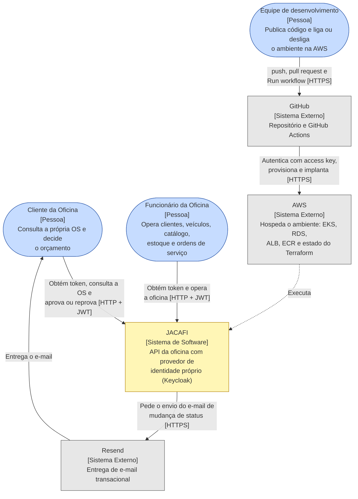

- **Cliente** é um usuário autenticado: consulta o status da própria OS e aprova ou reprova o orçamento pela API.
- **Funcionário** alcança todos os recursos da oficina.
- **Keycloak** faz parte do sistema, porque é implantado junto com a API, no mesmo cluster e pelo mesmo pipeline. Em `docs/c4-model.md` ele aparece como sistema externo no nível 1; a divergência é de enquadramento, não de comportamento.
- **No EKS o tráfego é HTTP sem TLS:** não há domínio nem certificado (ver R6).

## 4. C4 nível 2: containers

### 4.1 Containers de execução

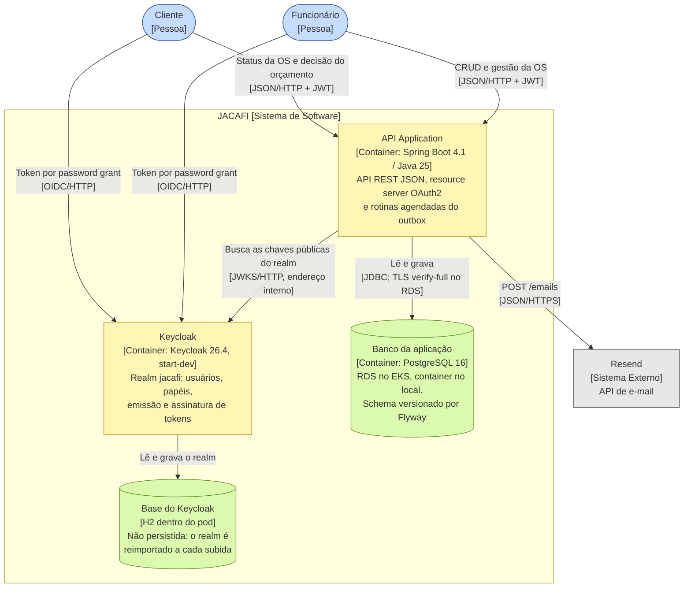

| Container | Local (Compose) | EKS | Evidência |
|---|---|---|---|
| API | `localhost:8082` | ALB `:80` → NodePort 30080 → Service `api:8082` | `docker-compose.yaml:61`, `k8s/overlays/eks/service-api.yaml` |
| Keycloak | `localhost:8081` | ALB `:8080` → NodePort 30081 → Service `keycloak:8080` | `docker-compose.yaml:30`, `k8s/overlays/eks/service-keycloak.yaml` |
| Banco | `postgres:16-alpine` com volume `pgdata` | RDS `db.t4g.micro`, sem backup | `docker-compose.yaml:2-23`, `infra/rds.tf` |
| Base do Keycloak | H2 do container | H2 do pod | `k8s/components/keycloak/keycloak.yaml:21` (`start-dev`) |

**Issuer e JWKS em endereços diferentes, de propósito.** O `iss` do token é o endereço público do Keycloak, visto pelo cliente: `http://<ALB>:8080/realms/jacafi` no EKS (`k8s/overlays/eks/keycloak.yaml:11-12`). A API valida esse `iss` (`KEYCLOAK_ISSUER_URI`), mas busca as chaves pelo Service interno `http://keycloak:8080` (`KEYCLOAK_JWK_SET_URI`, `k8s/overlays/eks/configmap.yaml:8-9`). O realm usa `sslRequired: none`, condição para emitir tokens por HTTP fora da rede local.

### 4.2 Containers de entrega

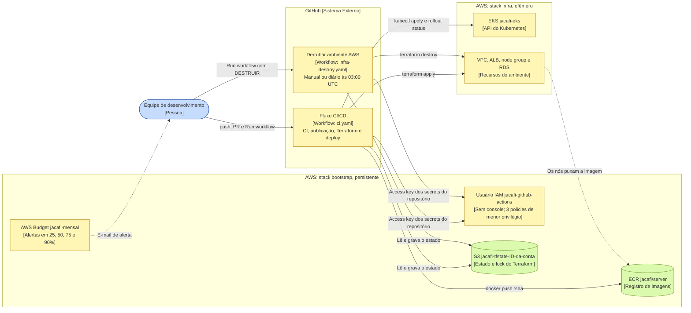

Dois stacks Terraform, com ciclos de vida diferentes:

| Stack | Pasta | Quem aplica | Estado | Ciclo de vida |
|---|---|---|---|---|
| Bootstrap | `infra/bootstrap/` | Administrador da conta, uma vez, da própria máquina | Local, `infra/bootstrap/terraform.tfstate`, ignorado pelo Git | Persistente |
| Ambiente | `infra/` | Pipeline, com a access key do usuário IAM | S3, chave `jacafi/infra.tfstate`, com `use_lockfile` (`infra/backend.tf:4-8`) | Efêmero |

## 5. C4 nível 3: componentes

### 5.1 Componentes da API Application

```mermaid
flowchart TD
    classDef controller fill:#c6dcff,stroke:#305bab
    classDef service fill:#fff6b6,stroke:#af7e02
    classDef domain fill:#adf0c7,stroke:#087429
    classDef port fill:#ffd9b3,stroke:#b35c00
    classDef infra fill:#e7e7e7,stroke:#595959
    classDef db fill:#dbfaad,stroke:#608520

    subgraph API["API Application [Container: Spring Boot]"]
        direction TB

        subgraph Borda["Adapter IN: borda HTTP"]
            trace["TraceIdFilter<br/>[Filtro, maior precedência]<br/>Gera ou propaga X-Trace-Id"]:::infra
            rs["OAuth2 Resource Server<br/>[Spring Security: SecurityConfig]<br/>Assinatura, expiração, issuer<br/>e regras por rota"]:::infra
            conv["KeycloakJwtAuthenticationConverter<br/>[Componente]<br/>realm_access.roles para ROLE_*<br/>e sub para customerId"]:::infra
            errors["GlobalExceptionHandler e<br/>SecurityProblemDetailHandler<br/>[Componente]<br/>Erros em ProblemDetail, sem stack trace"]:::infra
        end

        subgraph Web["Adapter IN: controllers REST"]
            ctrls["Customer, Vehicle, LaborOperation,<br/>Inventory e ServiceOrder Controllers<br/>[Um controller por fatia, /api/v1]"]:::controller
        end

        subgraph Agenda["Adapter IN: rotinas agendadas"]
            auditProc["AuditOutboxProcessor<br/>[Scheduled a cada 5 s, lote de 20]"]:::infra
            mailProc["ServiceOrderStatusNotificationProcessor<br/>[Scheduled a cada 5 s, lote de 20]"]:::infra
        end

        subgraph App["Application: casos de uso e portas"]
            cfg["Configuration de cada fatia<br/>[Composition root]<br/>Registra os casos de uso como beans"]:::service
            usecases["Casos de uso<br/>[Ex.: OpenServiceOrderService,<br/>ApproveEstimateService]<br/>Transação por @Transactional"]:::service
            policies["AccessPolicy de cada fatia<br/>[Componente]<br/>Papel exigido e posse do dado"]:::service
            ports["Portas de saída<br/>[Repository ports, AuditTrailPort,<br/>StatusNotificationPort, InventoryAuditLedgerPort]"]:::port
            secPorts["CurrentAuthenticatedUserPort e<br/>CustomerIdentityPort<br/>[shared/security]"]:::port
        end

        subgraph Dom["Domain: regras de negócio"]
            dom["ServiceOrder + Estimate, Customer + TaxId,<br/>Vehicle + LicensePlate, LaborOperation,<br/>InventoryItem + Stock<br/>[Agregados, entidades e VOs]"]:::domain
        end

        subgraph Out["Adapter OUT"]
            jpa["Persistence Adapters<br/>[JPA, um por fatia]"]:::infra
            identity["CustomerIdentityPersistenceAdapter<br/>[JPA: customer_identities]"]:::infra
            outboxPub["JpaAuditTrail, OutboxStatusNotificationAdapter<br/>e EventOutboxPublisher<br/>[Gravam event_outbox na transação do caso de uso]"]:::infra
            resendSender["ResendStatusEmailSender<br/>[RestClient com Idempotency-Key]"]:::infra
        end
    end

    kc["Keycloak<br/>[Container]"]:::infra
    db[("PostgreSQL<br/>[Container]")]:::db
    resend["Resend<br/>[Sistema Externo]"]:::infra

    trace --> rs
    rs -->|"Busca as chaves [JWKS]"| kc
    rs -->|"JWT válido"| conv
    conv -->|"Consulta o vínculo"| secPorts
    rs -->|"Requisição autorizada"| ctrls
    ctrls --> usecases
    ctrls -.->|"Exceções"| errors
    cfg -.->|"Instancia"| usecases
    usecases --> policies
    policies -->|"Quem está autenticado"| secPorts
    usecases --> dom
    usecases --> ports
    jpa -.->|"Implementa"| ports
    outboxPub -.->|"Implementa"| ports
    identity -.->|"Implementa"| secPorts
    jpa -->|"SQL"| db
    identity -->|"SQL"| db
    outboxPub -->|"INSERT event_outbox"| db
    auditProc -->|"Lê PENDING e grava audit_trail"| db
    mailProc -->|"Lê PENDING"| db
    mailProc --> resendSender
    resendSender -->|"POST /emails [HTTPS]"| resend
```

Pontos que o diagrama resume:

- **Composição:** as classes de `application/service` não são beans anotados. Cada fatia tem uma classe `*Configuration` que as instancia, como `server/src/main/java/com/jacafi/tech/serviceorder/config/ServiceOrderConfiguration.java`, com 12 beans. A única dependência de Spring nessa camada é `@Transactional`, importada em 22 classes de `application/service` (ver R10).
- **Autorização em duas camadas:**
  - `SecurityConfig` exige `EMPLOYEE` em toda rota, exceto `/me`, a consulta de status e a decisão do orçamento, que pedem só autenticação (`server/src/main/java/com/jacafi/tech/config/SecurityConfig.java:51-73`).
  - As `*AccessPolicy` conferem, para `CUSTOMER`, a posse do dado.
- **Papéis e vínculo do cliente:** o conversor traduz `realm_access.roles` em `ROLE_EMPLOYEE` ou `ROLE_CUSTOMER` (`KeycloakJwtAuthenticationConverter.java:22,70`). Ele também resolve o `customerId` pelo `sub` do token, uma vez por requisição (`KeycloakJwtAuthenticationConverter.java:60`).
- **Outbox:** `EventOutboxPublisher` exige transação existente (`Propagation.MANDATORY`, `EventOutboxPublisher.java:25,40`). O evento só existe se o caso de uso confirmar.
- **Atalho de camada:** `ServiceOrderStatusNotificationProcessor`, um adaptador de entrada, chama direto `ResendStatusEmailSender`, um adaptador de saída, sem passar por caso de uso. Avalie se isso fere a ADR-001.

### 5.2 Componentes do Fluxo CI/CD

Aqui o container é o workflow, e os componentes são os jobs. As setas seguem os `needs` de `.github/workflows/ci.yaml`.

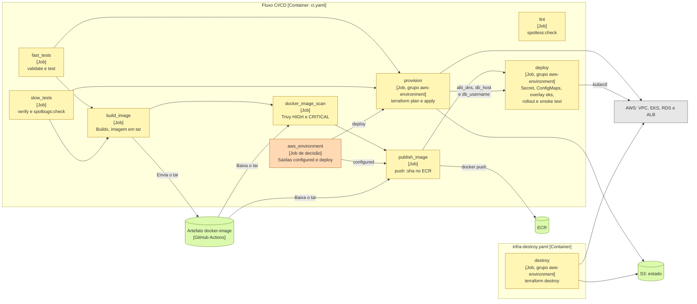

| Job | Depende de | Roda quando | Permissões | Evidência |
|---|---|---|---|---|
| `lint` | nada | sempre | `contents: read` | `ci.yaml:27-49` |
| `fast_tests` | nada | sempre | `contents: read` | `ci.yaml:51-76` |
| `slow_tests` | nada | sempre | `contents: read` | `ci.yaml:78-105` |
| `build_image` | `fast_tests`, `slow_tests` | sempre | `contents: read` | `ci.yaml:107-130` |
| `docker_image_scan` | `build_image` | sempre | `contents: read` | `ci.yaml:132-154` |
| `aws_environment` | nada | fora de PR, só na `main` | `contents: read` | `ci.yaml:161-209` |
| `publish_image` | `docker_image_scan`, `aws_environment` | `configured == 'true'` | `contents: read` | `ci.yaml:211-241` |
| `provision` | `fast_tests`, `slow_tests`, `aws_environment` | `deploy == 'true'` | `contents: read` | `ci.yaml:243-303` |
| `deploy` | `publish_image`, `provision` | os dois com sucesso | `contents: read` | `ci.yaml:305-419` |
| `destroy` | nada | `schedule`, ou manual com `DESTRUIR` | `contents: read` | `infra-destroy.yaml:24-92` |

Nenhum job pede `id-token`: as credenciais da AWS vêm dos secrets do repositório (ver 7.4). Os jobs de AWS leem `AWS_ACCESS_KEY_ID` e `AWS_SECRET_ACCESS_KEY` direto, sem environment.

Divergências entre os jobs e a documentação existente:

- **`lint` não bloqueia nada.** Nenhum job depende dele. O diagrama de `docs/cicd/pipeline-ci.md:35-36` desenha `lint → fast_tests` e `lint → slow_tests`, o que não corresponde ao `ci.yaml`. Na prática, o Spotless também roda em `fast_tests`, porque está ligado à fase `validate` (`server/pom.xml:144`).
- **`provision` não espera o scan da imagem** (ver R4).

## 6. Implantação

### 6.1 AWS

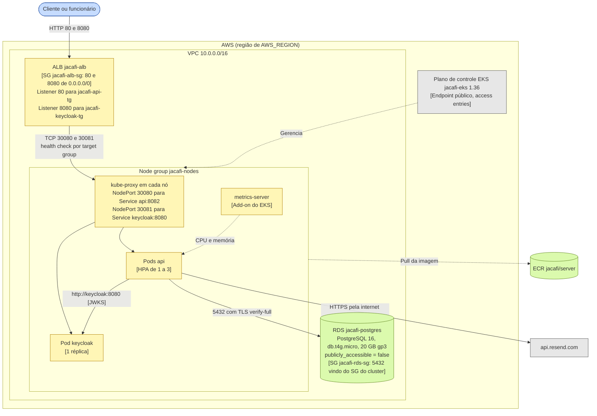

**Rede e nós.** A VPC tem internet gateway e três subnets públicas, `10.0.1.0/24`, `10.0.2.0/24` e `10.0.3.0/24`, uma por zona de disponibilidade (`infra/subnets.tf:1-13`). O node group `jacafi-nodes` tem 3 nós `t3.small` com AL2023, num ASG de 1 a 3 nós, e usa o security group do cluster (`infra/eks_node_group.tf`, `infra/variables.tf:41-60`).

**Como o ALB chega aos pods.** Não há AWS Load Balancer Controller nem Ingress. O Terraform cria o ALB, os target groups do tipo `instance` e anexa os dois target groups ao Auto Scaling Group do node group (`infra/t-group.tf:45-53`). Cada nó atende os NodePorts fixos, e o kube-proxy encaminha para o pod, em qualquer nó. Os NodePorts precisam bater entre `infra/variables.tf:67-77` e `k8s/overlays/eks/service-*.yaml`.

**Health checks dos target groups** (`infra/t-group.tf:8-16,30-38`): a API responde em `/actuator/health/readiness` e o Keycloak em `/realms/jacafi`. Os dois esperam `200`, com intervalo de 15 s, 2 sucessos e 3 falhas.

### 6.2 Fluxos de rede

| Origem | Destino | Porta | Regra | Evidência |
|---|---|---|---|---|
| Internet | ALB | 80/tcp | SG `jacafi-alb-sg`, `0.0.0.0/0` | `infra/s-group.tf:5-11` |
| Internet | ALB | 8080/tcp | SG `jacafi-alb-sg`, `0.0.0.0/0` | `infra/s-group.tf:13-19` |
| ALB | Nós | 30080 e 30081/tcp | SG do cluster, origem SG do ALB | `infra/s-group-nodes.tf:1-13` |
| Nós e pods | RDS | 5432/tcp | SG `jacafi-rds-sg`, origem SG do cluster | `infra/s-group-nodes.tf:15-22` |
| Pod da API | Service `keycloak` | 8080/tcp | Rede do cluster | `k8s/overlays/eks/configmap.yaml:9` |
| Pod da API | `api.resend.com` | 443/tcp | Saída pela internet gateway, com o IP público do nó | `infra/subnets.tf:7`, `infra/route_table.tf:4-7` |
| Nós | ECR e API do EKS | 443/tcp | Saída pela internet gateway | `infra/route_table.tf:4-7` |
| Internet | API do EKS | 443/tcp | Endpoint público, sem restrição de CIDR | `infra/eks.tf:6-10` |

### 6.3 Objetos Kubernetes no namespace `jacafi` (overlay eks)

| Objeto | Origem | Observação |
|---|---|---|
| Namespace `jacafi` | `k8s/base/namespace.yaml` | O pipeline também o aplica isoladamente, antes do Secret (`ci.yaml:336`) |
| ConfigMap `jacafi-config` | `k8s/base/configmap.yaml` com o patch `k8s/overlays/eks/configmap.yaml` | Recebe os placeholders `EKS_*` |
| Secret `jacafi-secrets` | Criado pelo pipeline (`ci.yaml:338-351`) | `DB_USERNAME`, `DB_PASSWORD`, `KEYCLOAK_ADMIN`, `KEYCLOAK_ADMIN_PASSWORD`, `RESEND_API_KEY` |
| ConfigMap `keycloak-realm` | Criado pelo pipeline a partir de `keycloak/jacafi-realm.json` (`ci.yaml:355`) | Montado em `/opt/keycloak/data/import` |
| ConfigMap `rds-ca` | Criado pelo pipeline, com o `global-bundle.pem` da AWS (`ci.yaml:356-357`) | Montado em `/etc/postgresql/certs` (`k8s/overlays/eks/api.yaml`) |
| Deployment `api` | `k8s/base/api.yaml`, componente `autoscaling` e patch `k8s/overlays/eks/api.yaml` | Pede 250m e 512Mi, limita a 1 CPU e 1Gi. Tem init container `pg_isready` e probes de startup, readiness e liveness. Usa `RollingUpdate` com `maxSurge: 1` |
| Service `api` | `k8s/base/api.yaml` com o patch `service-api.yaml` | NodePort 30080 para a porta 8082 |
| HPA `api` | `k8s/components/autoscaling/autoscaling.yaml` | De 1 a 3 réplicas, CPU média de 70% e memória média de 800Mi |
| Deployment `keycloak` | `k8s/components/keycloak/keycloak.yaml` com o patch `k8s/overlays/eks/keycloak.yaml` | Uma réplica, `Recreate`, `start-dev --import-realm`, `KC_HOSTNAME=http://<ALB>:8080` |
| Service `keycloak` | `k8s/components/keycloak/keycloak.yaml` com o patch `service-keycloak.yaml` | NodePort 30081 para a porta 8080 |

**Endurecimento do pod da API** (`k8s/base/api.yaml:17-25,47-51,86-90`):

- não monta o token da service account;
- roda como não root, com UID 10001 e seccomp `RuntimeDefault`;
- usa sistema de arquivos somente leitura, com `/tmp` em `emptyDir`;
- descarta todas as capabilities, sem escalada de privilégio.

### 6.4 Outros ambientes

| Ambiente | Como sobe | Banco | Keycloak | Escala |
|---|---|---|---|---|
| Compose | `docker compose --env-file .env.example up -d --build` | Container `postgres:16-alpine` com volume | `start-dev`, porta 8081 | 1 réplica |
| Kubernetes local | `kubectl apply -k k8s/overlays/local`, no Docker Desktop | PVC e Deployment PostgreSQL (`k8s/overlays/local/database.yaml`) | Componente `keycloak` | 1 réplica, `Recreate` |
| Teste de carga | `kubectl apply -k k8s/overlays/load-test` | Herdado do local, em outro namespace | Herdado do local | HPA de 1 a 3 |

## 7. Sequências do pipeline

### 7.1 Gatilhos

| Gatilho | Workflow | O que roda |
|---|---|---|
| `pull_request` para `main` | Fluxo CI/CD | Só CI. Os jobs de AWS não rodam em PR, então a access key não é usada |
| `push` na `main` | Fluxo CI/CD | CI e publicação da imagem. Provisão e deploy só se o cluster estiver `ACTIVE` |
| `workflow_dispatch` na `main` | Fluxo CI/CD | CI, publicação, provisão e deploy: sobe ou atualiza o ambiente completo |
| `workflow_dispatch` com `DESTRUIR` | Derrubar ambiente AWS | `terraform destroy` |
| `schedule` `0 3 * * *` | Derrubar ambiente AWS | `terraform destroy`, todo dia à meia-noite de Brasília |

### 7.2 Pull request

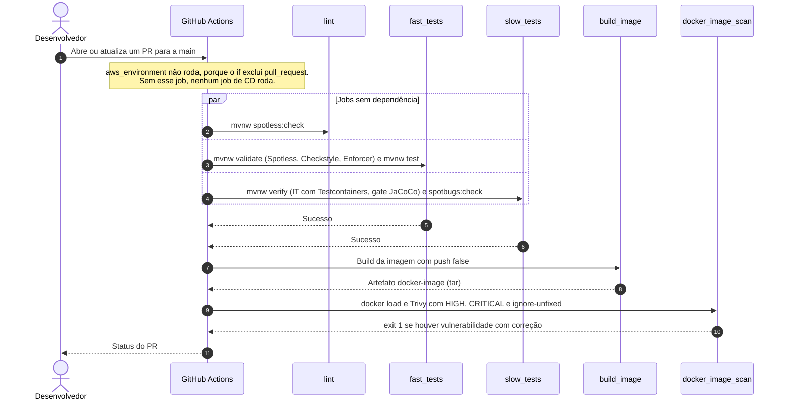

### 7.3 Run workflow: visão por job

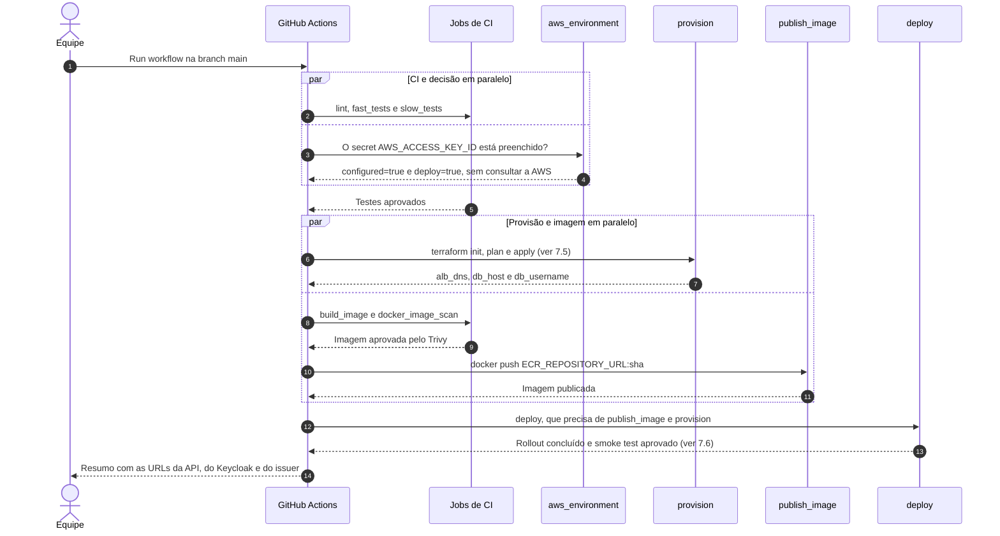

A primeira execução leva cerca de 25 minutos, a maior parte na criação do EKS e do RDS (`infra/README.md:171`).

### 7.4 Autenticação na AWS por access key

O pipeline não usa OIDC: o plano Free da AWS aplica uma service control policy que nega `iam:*Provider*`, então o provedor de identidade do GitHub não pode ser criado (`infra/README.md:110`). Cada job de CD repete este fluxo: `aws_environment` (só no push), `publish_image`, `provision`, `deploy` e `destroy`.

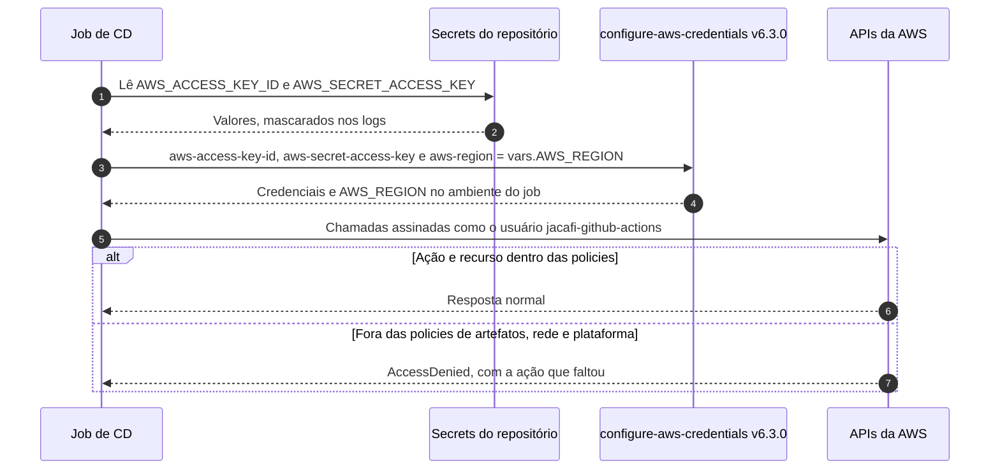

Evidências:

- **Usuário e policies:** `aws_iam_user.pipeline` e as policies `jacafi-pipeline-artefatos`, `-rede` e `-plataforma`, em `infra/bootstrap/github_pipeline_user.tf`. Sem acesso ao console e sem `ec2:RunInstances` nem ações sobre usuários IAM.
- **Criação da chave:** pela CLI, fora do Terraform, para o segredo não ir parar no estado do bootstrap (`infra/README.md:123-133`).
- **Validade:** a chave não expira e a rotação é manual (R16).
- **Quem pode usar:** os jobs de AWS do `ci.yaml` só rodam na `main` (`ci.yaml:163`), mas os secrets são do repositório. Quem tem escrita pode usar a chave em um workflow de outra branch (`infra/README.md:120`).
- **Região:** os passos `run` usam `$AWS_REGION`, exportada pela action, por exemplo no `terraform init` e no `update-kubeconfig`.

### 7.5 Provisão (job `provision`)

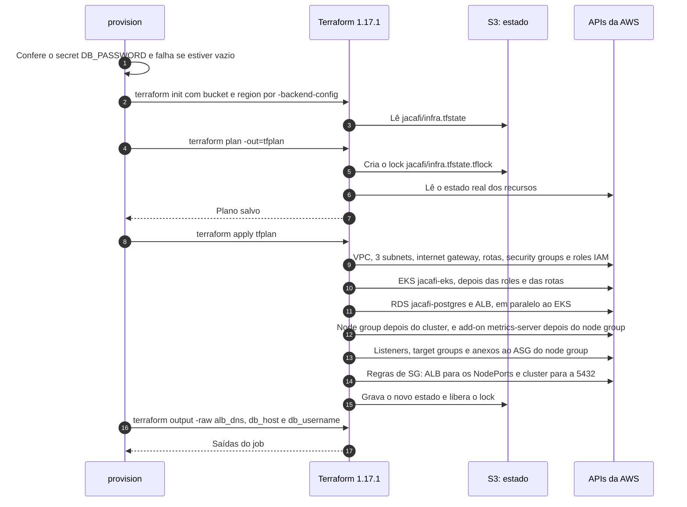

Ordem garantida por dependências explícitas e implícitas:

- **Cluster:** depende das roles e das rotas (`infra/eks.tf:18-21`).
- **Node group:** depende da role dos nós (`infra/eks_node_group.tf:22`).
- **Add-on:** depende do node group (`infra/eks_addon.tf:6`).
- **Anexos ao ASG:** leem `aws_eks_node_group.main.resources[0].autoscaling_groups[0].name` (`infra/t-group.tf:46`).
- **Regras de SG dos nós:** usam o SG criado pelo EKS (`infra/s-group-nodes.tf:7`).

### 7.6 Deploy no EKS (job `deploy`)

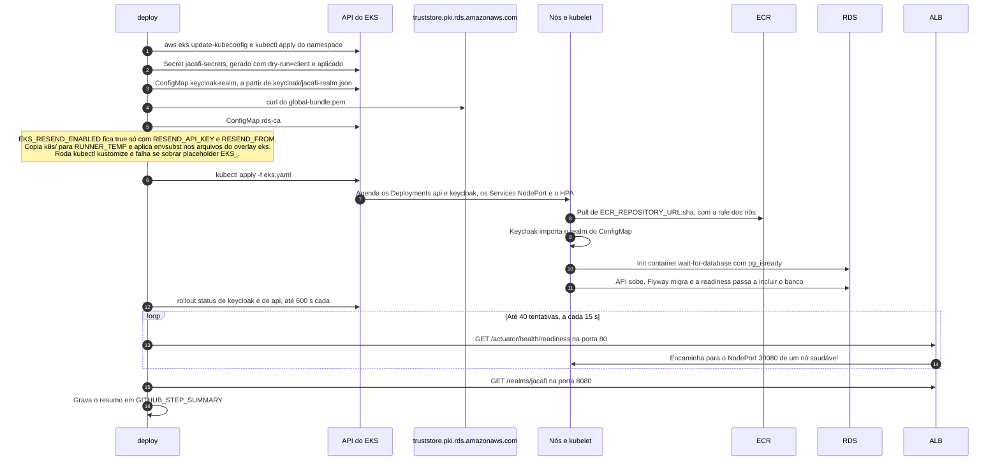

**Por que a substituição acontece antes do Kustomize** (`ci.yaml:369-378`): se o `envsubst` rodasse no YAML já gerado, `RESEND_ENABLED: "${EKS_RESEND_ENABLED}"` viraria `RESEND_ENABLED: true` sem aspas. Isso é um booleano YAML, e o ConfigMap seria rejeitado. Substituindo nos arquivos de origem, as aspas continuam no lugar. A lista de variáveis do `envsubst` é explícita, então `$DB_HOST` no comando do init container (`k8s/base/api.yaml:32`) não é tocado.

### 7.7 Push na main

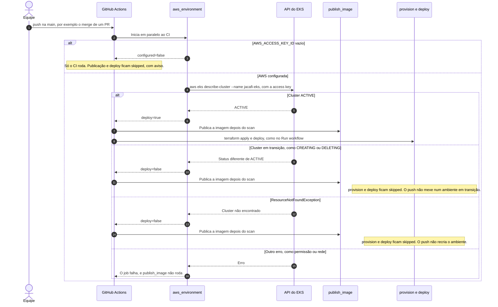

O gate exige cluster `ACTIVE` (`ci.yaml:195-202`); um cluster em `DELETING` ou `CREATING` só publica a imagem (corrige o R5).

### 7.8 Derrubar ambiente

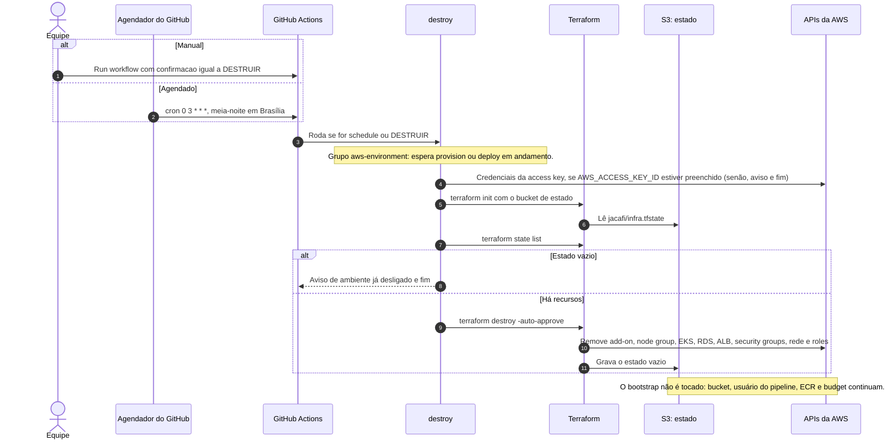

O RDS não tem backup nem snapshot final (`infra/rds.tf:21-24`), então os dados do banco não sobrevivem ao destroy. Isso é intencional.

### 7.9 Bootstrap, uma única vez

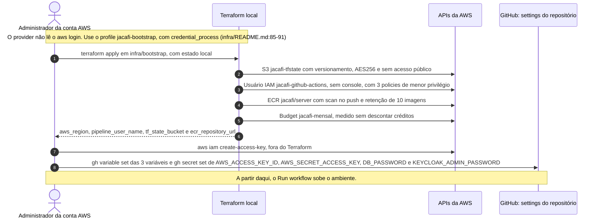

## 8. Sequências da aplicação

Estas duas sequências não fazem parte do pipeline, mas ajudam a revisar a segurança e o outbox com várias réplicas.

### 8.1 Requisição autenticada

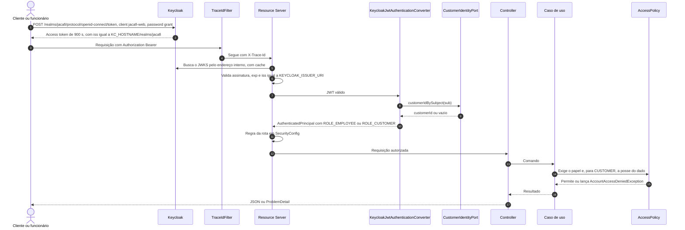

### 8.2 Aprovação do orçamento, outbox e e-mail

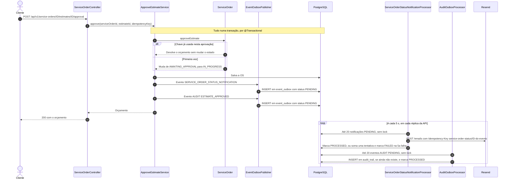

Observações para a revisão:

- **Replay da aprovação:** no replay com a mesma chave, o domínio devolve o orçamento sem mudar o estado. Mesmo assim, o caso de uso salva a OS e publica os dois eventos (ver R1).
- **Resend desligado:** com `RESEND_ENABLED=false`, o sender só registra um log, e o evento é marcado `PROCESSED` (`ResendStatusEmailSender.java:41-45`).
- **Limite de tentativas:** o evento vira `FAILED` na quinta falha (`EventOutboxJpaEntity.java:98-104`).

## 9. Configuração e segredos

### 9.1 Variables e secrets do GitHub

| Nome | Tipo | Obrigatório | Usado por | Destino |
|---|---|---|---|---|
| `AWS_ACCESS_KEY_ID` | Secret | Sim; vazio, o CD é ignorado com aviso | Todos os jobs de CD e `destroy` | `aws-access-key-id` |
| `AWS_SECRET_ACCESS_KEY` | Secret | Sim, par da anterior | Todos os jobs de CD e `destroy` | `aws-secret-access-key` |
| `AWS_REGION` | Variable | Sim | Todos os jobs de CD e `destroy` | `aws-region` e `TF_VAR_aws_region`; `$AWS_REGION` no backend |
| `TF_STATE_BUCKET` | Variable | Sim | `provision`, `destroy` | `-backend-config="bucket=…"` |
| `ECR_REPOSITORY_URL` | Variable | Sim | `publish_image`, `deploy` | Tag do push; `EKS_IMAGE_REPOSITORY` |
| `EKS_ADMIN_PRINCIPAL_ARNS` | Variable | Não; padrão `[]` | `provision`, `destroy` | `TF_VAR_cluster_admin_principal_arns` |
| `KEYCLOAK_ADMIN` | Variable | Não; padrão `admin` | `deploy` | Secret `jacafi-secrets` |
| `RESEND_FROM` | Variable | Não | `deploy` | `EKS_RESEND_FROM`, que vai para o ConfigMap |
| `DB_PASSWORD` | Secret | Sim | `provision`, `destroy`, `deploy` | `TF_VAR_db_password` e Secret `jacafi-secrets` |
| `KEYCLOAK_ADMIN_PASSWORD` | Secret | Sim | `deploy` | Secret `jacafi-secrets` |
| `RESEND_API_KEY` | Secret | Não | `deploy` | Secret `jacafi-secrets`; junto com `RESEND_FROM`, liga os e-mails |

A senha do banco também fica no estado do Terraform, no S3 criptografado (`infra/README.md:222`). As restrições de caracteres dela estão em `infra/README.md:153`.

### 9.2 Placeholders do overlay eks

| Placeholder | Valor | Onde aparece |
|---|---|---|
| `EKS_IMAGE_REPOSITORY` | `vars.ECR_REPOSITORY_URL` | `k8s/overlays/eks/kustomization.yaml:11` |
| `EKS_IMAGE_TAG` | `github.sha` | `k8s/overlays/eks/kustomization.yaml:12` |
| `EKS_ALB_DNS` | Saída `alb_dns` do Terraform | `k8s/overlays/eks/configmap.yaml:8`, `k8s/overlays/eks/keycloak.yaml:12` |
| `EKS_DB_HOST` | Saída `db_host` do Terraform | `k8s/overlays/eks/configmap.yaml:6-7` |
| `EKS_RESEND_ENABLED` | `true` se houver `RESEND_API_KEY` e `RESEND_FROM`; senão `false` | `k8s/overlays/eks/configmap.yaml:12` |
| `EKS_RESEND_FROM` | `vars.RESEND_FROM` | `k8s/overlays/eks/configmap.yaml:13` |

### 9.3 Configuração da API

| Variável | Local (Compose) | EKS | Evidência |
|---|---|---|---|
| `DB_URL` | `.env.example` | `jdbc:postgresql://<RDS>:5432/jacafi?sslmode=verify-full&sslrootcert=…` | `k8s/overlays/eks/configmap.yaml:7` |
| `KEYCLOAK_ISSUER_URI` | `http://localhost:8081/realms/jacafi` | `http://<ALB>:8080/realms/jacafi` | `docker-compose.yaml:71`, `k8s/overlays/eks/configmap.yaml:8` |
| `KEYCLOAK_JWK_SET_URI` | `http://keycloak:8080/…/certs` | `http://keycloak:8080/…/certs` | `docker-compose.yaml:72`, `k8s/overlays/eks/configmap.yaml:9` |
| `SPRINGDOC_*_ENABLED` | `true` | `true` | `k8s/overlays/eks/configmap.yaml:10-11` |
| `MANAGEMENT_ENDPOINT_HEALTH_GROUP_READINESS_INCLUDE` | padrão do Spring | `readinessState,db` | `k8s/base/configmap.yaml:17` |
| `SERVER_SHUTDOWN` e `SPRING_LIFECYCLE_TIMEOUT_PER_SHUTDOWN_PHASE` | padrão do Spring | `graceful` e `30s`, com `terminationGracePeriodSeconds: 45` | `k8s/base/configmap.yaml:15-16`, `k8s/base/api.yaml:18` |
| `RESEND_ENABLED`, `RESEND_FROM`, `RESEND_API_KEY` | `.env` local | ConfigMap e Secret | `server/src/main/resources/application.yaml` |

## 10. Decisões e trade-offs

| # | Decisão | Motivo | Consequência aceita | Evidência |
|---|---|---|---|---|
| D1 | Ambiente efêmero: sobe com Run workflow e cai manualmente ou à meia-noite | O EKS cobra US$ 0,10/h mesmo sem pods; ligado direto, consumiria os créditos em cerca de 3 semanas | Dados perdidos a cada sessão; primeira subida de cerca de 25 min | `infra/README.md:10`, `infra-destroy.yaml:13-14` |
| D2 | Dois stacks Terraform | Estado, usuário do pipeline e imagens sobrevivem ao destroy | O estado do bootstrap é local e precisa ser guardado | `infra/README.md:106` |
| D3 | ALB do Terraform apontando para NodePorts, sem Load Balancer Controller nem Ingress | Menos peças: sem IRSA, Helm nem CRDs. O destroy não deixa ELB órfão criado pelo Kubernetes | NodePorts fixos, que precisam bater entre Terraform e manifestos; o ALB registra todos os nós | `infra/t-group.tf`, `k8s/overlays/eks/service-*.yaml` |
| D4 | Só subnets públicas, sem NAT gateway | O NAT custaria cerca de US$ 0,045/h, mais o tráfego | Nós com IP público; RDS em subnet pública, mas sem IP público | `infra/subnets.tf:7,17`, `infra/rds.tf:17` |
| D5 | Access entries com `authentication_mode = "API"`, e admin para quem cria o cluster | Dispensa o ConfigMap `aws-auth` | Se o cluster for criado fora do pipeline, o usuário do pipeline precisa entrar em `cluster_admin_principal_arns` | `infra/eks.tf:13-16`, `infra/README.md:226` |
| D6 | RDS com TLS `verify-full` e o bundle global da AWS | Garante a identidade do servidor do banco | O deploy depende de `truststore.pki.rds.amazonaws.com` | `ci.yaml:356`, `k8s/overlays/eks/configmap.yaml:7` |
| D7 | Keycloak `start-dev` no cluster, com o realm vindo de ConfigMap | Simples e sem banco extra | Não serve para produção; usuários criados no console somem a cada recriação do pod | `k8s/components/keycloak/keycloak.yaml:21` |
| D8 | HTTP sem TLS no ALB | Não há domínio nem certificado | Tokens trafegam sem criptografia | `infra/alb_listener.tf`, `infra/README.md:246` |
| D9 | Usuário IAM do pipeline com access key e três policies de menor privilégio, no lugar de OIDC | O plano Free bloqueia `iam:*Provider*`, então o provedor OIDC não pode ser criado | Credencial de longa duração (R16); as policies precisam acompanhar o que o Terraform usa, ou o job falha com `AccessDenied` | `infra/bootstrap/github_pipeline_user.tf`, `infra/README.md:110` |
| D10 | Imagem publicada só depois do Trivy, com tag igual ao SHA do commit | Rastreabilidade entre commit e imagem | O ECR aceita tags mutáveis, mas o SHA não se repete | `ci.yaml:211-241`, `infra/bootstrap/ecr.tf:4` |
| D11 | Placeholders com `envsubst` em vez de Helm | Mantém o Kustomize que já existia | Lista de placeholders mantida à mão; o pipeline falha se sobrar algum | `ci.yaml:374-383` |
| D12 | Actions fixadas por SHA, com a versão em comentário | Cadeia de suprimentos | Atualização manual das versões | `ci.yaml` (todas as ocorrências de `uses:`) |
| D13 | Outbox processado dentro da própria API, por `@Scheduled` | Dispensa um broker | Várias réplicas processam os mesmos eventos (R3) | ADR-004 |

## 11. Estado de verificação

### 11.1 Validado localmente (✅)

O código da aplicação não mudou depois desses testes; as alterações seguintes foram só de pipeline, Terraform, manifestos e documentação.

| O quê | Como | Resultado |
|---|---|---|
| Build e testes | `mvn verify` no container `maven:3.9-eclipse-temurin-25`, com o socket do Docker para o Testcontainers | 159 testes unitários e 21 de integração passando |
| Cobertura | JaCoCo, gate de 80% nos pacotes `domain` e `application` (`server/pom.xml:318-327`) | Gate aprovado; 70,5% das linhas no total |
| SAST | `spotbugs:check` com FindSecBugs | 0 achados |
| Imagem | Trivy 0.70.0, HIGH e CRITICAL com correção | 0 vulnerabilidades |
| Terraform | `terraform fmt -check` e `terraform validate` em `infra/` e `infra/bootstrap/` | Sem erros |
| Manifestos | `kubectl kustomize` em todos os overlays e `kubeconform` contra o Kubernetes 1.36.0 | 14 recursos válidos no overlay eks, com e sem e-mail |
| Renderização do overlay eks | Mesmo script do pipeline, com valores fictícios | `RESEND_ENABLED` continua string (`"true"` ou `"false"`), nenhum placeholder sobra e `$DB_HOST` do init container é preservado |
| Workflows | `actionlint` nos dois workflows | Sem erros |
| Actions | Consulta de cada SHA na API do GitHub | Os 11 SHAs existem |
| Diagramas deste documento | Renderização com `mermaid-cli` | Todos renderizam |

### 11.2 Execução em nuvem (⏳)

- Os stacks Terraform, os manifestos do overlay `eks` e os workflows já estão integrados na `main`.
- **Pontos de atenção na conta AWS:**
  - confirmar se o plano Free da AWS aceita EKS na região escolhida;
  - confirmar se a cota de vCPU sob demanda da conta é de pelo menos 6, que é o que 3× `t3.small` exige.

## 12. Riscos conhecidos

Severidade estimada: **A** (alta), **M** (média), **B** (baixa).

| ID | Sev. | Risco | Evidência | Estado |
|---|---|---|---|---|
| R1 | M | **Replay da aprovação ou reprovação duplica e-mail e auditoria.** O domínio devolve o orçamento sem mudar o estado, mas o caso de uso salva e publica os eventos de novo. O novo evento tem outro ID, então a `Idempotency-Key` do Resend também muda, e o cliente recebe o e-mail outra vez. | `server/src/main/java/com/jacafi/tech/serviceorder/domain/entity/ServiceOrder.java:155-159`, `ApproveEstimateService.java:40-43` e o trecho equivalente de `RejectEstimateService.java` | 📄 Aberto |
| R2 | M | **OS reprovada fica sem saída.** A reprovação devolve a OS para `UNDER_DIAGNOSIS`, mas nenhum endpoint gera um novo orçamento: só a abertura chama `generateEstimate`, e a troca manual de status não aceita `AWAITING_APPROVAL`. Também não há transição para `REJECTED`, que depende da questão Q1 da linguagem ubíqua. | `ServiceOrder.java:184`, `OpenServiceOrderService.java:81-82`, `UpdateServiceOrderStatusService.java:58-62`, `README.md:128` | 📄 Aberto |
| R3 | M | **Outbox sem coordenação entre réplicas.** Cada réplica roda os dois `@Scheduled` e lê os mesmos `PENDING`, sem `FOR UPDATE SKIP LOCKED`, e a entidade não tem `@Version`. O HPA do EKS permite até 3 réplicas, e o rolling update cria uma a mais. Há duas mitigações parciais: o índice único `ux_audit_trail_outbox_event` faz falhar o lote duplicado de auditoria, que volta inteiro e é reprocessado, e a `Idempotency-Key` por evento evita e-mail duplicado no Resend dentro da janela de idempotência. | `AuditOutboxProcessor.java:32-37`, `ServiceOrderStatusNotificationProcessor.java:31-37`, `V09_20260830__create_event_outbox.sql:6-8`, `ResendStatusEmailSender.java:59`, `k8s/README.md:218` | 📄 Aberto; para demonstrar o HPA, a orientação é usar carga de leitura |
| R4 | B | **A provisão não espera o scan da imagem.** Se o Trivy reprovar, o ambiente já terá sido criado ou atualizado, o deploy é pulado e o custo corre sem aplicação. | `ci.yaml:245` | 📄 Escolha por tempo total; revisar |
| R5 | M | **Push durante o destroy recriaria o ambiente.** Um cluster em `DELETING` ainda responde ao `describe-cluster`. | `ci.yaml:195-202` | ✅ Corrigido: o gate exige status `ACTIVE`; outros status só publicam a imagem. Não testado em execução real |
| R6 | M | **Borda sem proteção:** HTTP sem TLS, console do Keycloak exposto em `:8080`, realm com `sslRequired: none` e usuários de desenvolvimento com senhas publicadas no README. | `infra/alb_listener.tf`, `infra/s-group.tf:13-19`, `README.md:73-76` | Aceito para a demonstração (D7, D8) |
| R7 | B | **Fila de concorrência do GitHub.** Cada grupo tem no máximo um job rodando e um pendente; um novo pendente cancela o anterior, mesmo com `cancel-in-progress: false`. Um destroy agendado e pendente pode ser cancelado por um `provision` que entre na fila depois. O grupo também fica livre entre `provision` e `deploy`, então um destroy pode rodar entre os dois. | `ci.yaml:245-247,309-311`, `infra-destroy.yaml:28-30` | 📄 Pela documentação do GitHub Actions; não testado |
| R8 | B | **Agendamento desativado por inatividade.** Em repositórios públicos, o GitHub desativa workflows agendados depois de 60 dias sem atividade, e a rede de segurança do destroy deixaria de rodar. | `infra-destroy.yaml:13-14` | ⏳ Depende da visibilidade do repositório |
| R9 | B | **Keycloak volátil.** O realm não traz chaves de assinatura (`components` vazio), então cada subida do pod deve gerar chaves novas: tokens emitidos antes de um restart deixam de validar, e usuários criados no console somem. | `keycloak/jacafi-realm.json`, `k8s/components/keycloak/keycloak.yaml:6-8,21` | 📄 Comportamento esperado do Keycloak, a confirmar |
| R10 | B | **Clean Architecture incompleta.** 22 classes de `application/service` importam `@Transactional` do Spring, e não há teste de arquitetura, como ArchUnit. Quatro casos de uso registrados não são chamados por ninguém: `StartServiceOrderDiagnosisService`, `GenerateServiceOrderEstimateService`, `CompleteServiceOrderService` e `DeliverServiceOrderService`. | `serviceorder/config/ServiceOrderConfiguration.java:73-113`, `UpdateServiceOrderStatusService.java:58-62` | 📄 Aberto |
| R11 | M | **Lacuna de testes em fluxos críticos.** Não há teste para a fila operacional (`ListOperationalServiceOrdersService`) nem para a consulta de status (`FindServiceOrderStatusService`). | `server/src/test/java` (nenhuma referência) | 📄 Aberto |
| R12 | B | **CI redundante.** `-Dskip.unit.tests=true` não existe no `pom.xml`, então `slow_tests` roda os testes unitários de novo. O job `lint` repete o Spotless que `fast_tests` já roda em `validate`. | `ci.yaml:101`, `server/pom.xml:144` | 📄 Aberto |
| R13 | A | **Conta AWS.** Não está confirmado que o plano Free aceite EKS; a cota de vCPU precisa ser de pelo menos 6; quando o crédito acaba no plano Free, a conta é suspensa. | `infra/README.md:82` | ⏳ Confirmar antes da primeira execução |
| R14 | B | **Rede permissiva.** Endpoint público do EKS sem restrição de CIDR; nós com IP público. | `infra/eks.tf:6-10`, `infra/subnets.tf:7` | Aceito (D4) |
| R15 | B | **Entregáveis da Fase 2:** objetivos, diagramas de arquitetura, collection Postman (`docs/api/jacafi.postman_collection.json`) e script de carga k6 (`k8s/load-test.k6.js`) incorporados ao repositório; resta apenas inserir a URL final do vídeo demonstrativo no `README.md` após a publicação. | `README.md`, `docs/api/`, `k8s/load-test.k6.js` | ✅ Tratado no repositório (pendente link do vídeo) |
| R16 | M | **Access key de longa duração.** O pipeline autentica com a chave de um usuário IAM, guardada nos secrets do repositório, sem expiração nem rotação agendada. Quem tem escrita no repositório pode usá-la em um workflow de outra branch; o `if` da `main` não impede isso. As policies de menor privilégio limitam o estrago. | `infra/bootstrap/github_pipeline_user.tf`, `infra/README.md:120` | 📄 Aberto; mitigação documentada: environment restrito à `main` e rotação manual |

## 13. Requisitos da Fase 2 e evidências

O enunciado (`requisitos_pt2.pdf`) não está versionado no repositório.

| Requisito | Situação | Evidência |
|---|---|---|
| Clean Code | Parcial | Código limpo no geral; casos de uso sem uso e duplicações pequenas (R10) |
| Clean Architecture | Parcial | Camadas separadas por fatia; `@Transactional` na aplicação, sem teste de arquitetura (R10) |
| Testes dos fluxos críticos | Parcial | Faltam a fila e a consulta de status (R11) |
| Abertura de OS, retornando a identificação | Cumprido | `ServiceOrderController.java:46-52` |
| Consulta de status | Cumprido | `ServiceOrderController.java:55-58`, `ServiceOrderStatus.java` |
| Aprovação e recusa do orçamento | Cumprido, com ressalvas | `ServiceOrderController.java:61-76`; ressalvas em R1 e R2 |
| Listagem ordenada por prioridade e antiguidade, sem concluídas e entregues | Cumprido | `ListOperationalServiceOrdersService.java`, `README.md:128` |
| Notificação de status por e-mail | Cumprido; exige conta no Resend | `ResendStatusEmailSender.java`, `ci.yaml:364-368` |
| Dockerfile e docker-compose | Cumprido | `server/Dockerfile`, `docker-compose.yaml` |
| Deployments, Services, ConfigMaps, Secrets e HPA | Cumprido | `k8s/`, seção 6.3 |
| Terraform do cluster e do banco, documentado | Cumprido no código (⏳) | `infra/`, `infra/README.md` |
| CI/CD: build, testes, imagem, deploy do banco, deploy no cluster | Cumprido no código (⏳) | `.github/workflows/ci.yaml`, seção 7 |
| Pastas `/k8s` e `/infra` | Cumprido | Raiz do repositório |
| README: descrição, execução local, Kubernetes e Terraform | Cumprido | `README.md`, `k8s/README.md`, `infra/README.md` |
| README: objetivos da fase | Cumprido | `README.md` |
| README: desenho da arquitetura (componentes, infra e fluxo de deploy) | Cumprido | `README.md`, `docs/c4-model.md`, `infra/README.md` |
| README: link da collection | Cumprido | `docs/api/jacafi.postman_collection.json`, `docs/api/README.md` e Swagger UI ativo local e no EKS |
| README e vídeo: escalabilidade | Cumprido no código | `k8s/load-test.k6.js`, `k8s/README.md`; resta publicar o vídeo e preencher o link no `README.md` |
| PDF no portal e acesso de `soat-architecture` | Fora do repositório | — |

## 14. Perguntas abertas para o revisor

1. **Startup da API no EKS.** Com `issuer-uri` e `jwk-set-uri` definidos, o Spring Boot 4.1 consulta o issuer público na subida? Se consultar, o pod precisa alcançar `http://<ALB>:8080` pela internet gateway. O SG do ALB permite isso, mas confirme que não há dependência circular com a readiness do Keycloak.
2. **Capacidade.** Três `t3.small` comportam, nos requests, 3 réplicas da API, 1 Keycloak, metrics-server, CoreDNS e os DaemonSets do EKS? Considere a memória alocável por nó e o limite de pods do VPC CNI no `t3.small`.
3. **Órfãos no destroy.** O `terraform destroy` remove tudo, sem ENIs ou security groups órfãos que travem a remoção da VPC? Não há Service `LoadBalancer` nem Ingress, então o Kubernetes não cria ELB próprio.
4. **Outbox (R3).** As mitigações atuais bastam para uma demonstração com escrita e 2 ou 3 réplicas, ou o claim com `FOR UPDATE SKIP LOCKED` é necessário antes da gravação do vídeo?
5. **Ordem do pipeline (R4).** Vale fazer `provision` depender de `docker_image_scan`, trocando tempo por custo?
6. **Primeira execução.** Algum passo do `deploy` depende de algo que só existe depois do primeiro `apply`, além das saídas já passadas pelo `provision`? Considere a access entry do usuário do pipeline e a propagação do DNS do ALB.
7. **`RESEND_FROM` e `DB_PASSWORD`.** Valores com caracteres especiais quebram o YAML renderizado ou a URL JDBC? Hoje as restrições existem só na documentação (`infra/README.md:152-153`).
8. **Cobertura das policies do pipeline.** As três policies de `github_pipeline_user.tf` cobrem todas as ações do `terraform apply` e do `destroy`? Só uma execução completa confirma; um `AccessDenied` traz a ação que faltou (R16).

## 15. Índice de evidências

| Área | Arquivos |
|---|---|
| Pipeline | `.github/workflows/ci.yaml`, `.github/workflows/infra-destroy.yaml`, `docs/cicd/pipeline-ci.md` |
| Terraform: ambiente | `infra/*.tf`, `infra/.terraform.lock.hcl`, `infra/README.md` |
| Terraform: bootstrap | `infra/bootstrap/*.tf`, `infra/bootstrap/terraform.tfvars.example` |
| Kubernetes | `k8s/base/`, `k8s/components/`, `k8s/overlays/`, `k8s/README.md` |
| Imagem e ambiente local | `server/Dockerfile`, `docker-compose.yaml`, `.env.example`, `docs/cicd/imagem-docker.md` |
| Identidade | `keycloak/jacafi-realm.json`, `server/src/main/java/com/jacafi/tech/config/SecurityConfig.java`, `server/src/main/java/com/jacafi/tech/shared/adapter/in/security/` |
| Outbox | `server/src/main/java/com/jacafi/tech/shared/adapter/out/persistence/EventOutbox*.java`, `server/src/main/java/com/jacafi/tech/shared/adapter/in/scheduling/AuditOutboxProcessor.java`, `server/src/main/java/com/jacafi/tech/serviceorder/adapter/in/scheduling/`, `server/src/main/java/com/jacafi/tech/serviceorder/adapter/out/notification/` |
| Ordem de serviço | `server/src/main/java/com/jacafi/tech/serviceorder/` |
| Decisões | `docs/adr/ADR-001` a `ADR-007`, `docs/c4-model.md`, `docs/linguagem-ubiqua.md` |
| Collection da API e carga | `docs/api/jacafi.postman_collection.json`, `docs/api/README.md`, `k8s/load-test.k6.js` |
| Qualidade e segurança | `server/pom.xml`, `docs/cobertura-testes.md`, `docs/security/vulnerability-analysis.md` |
