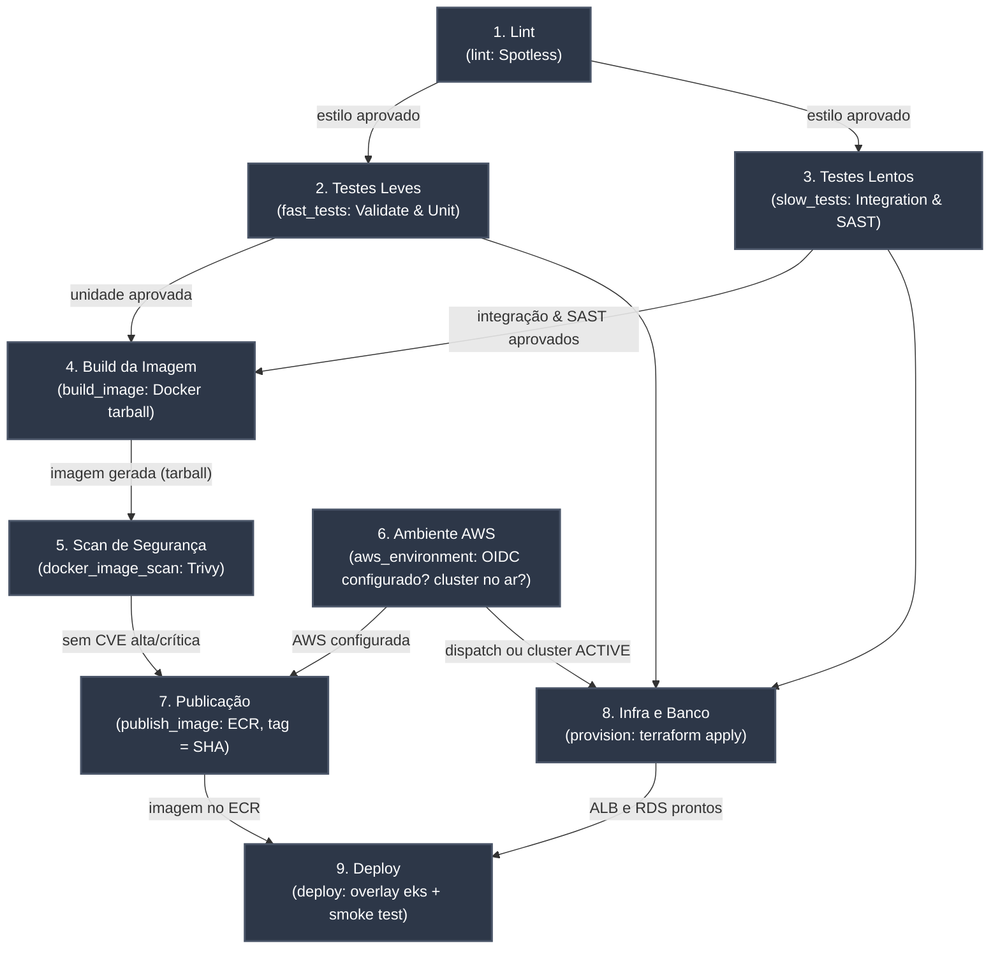

# Pipeline de Integração e Entrega Contínua (CI/CD)

O workflow em [.github/workflows/ci.yaml](../../.github/workflows/ci.yaml) implementa a esteira de CI/CD do projeto. Ela vai da verificação do código-fonte e da análise de vulnerabilidades da imagem até a publicação no ECR, o provisionamento com Terraform e o deploy no EKS. A infraestrutura e a configuração da AWS estão em [infra/README.md](../../infra/README.md).

## Triggers

O pipeline é disparado automaticamente nos seguintes eventos:

| Evento | Condição |
|---|---|
| `push` | Branch `main`: CI, publicação da imagem e atualização do ambiente AWS, se ele estiver no ar |
| `pull_request` | Branch `main` (target): somente CI, sem credenciais da AWS |
| `workflow_dispatch` | Execução manual na `main`: CI e subida (ou atualização) do ambiente AWS completo |

O workflow [infra-destroy.yaml](../../.github/workflows/infra-destroy.yaml) derruba o ambiente: manualmente, com a confirmação `DESTRUIR`, ou todo dia à meia-noite de Brasília.

---

## Visão Geral do Grafo (DAG)

A esteira foi projetada como um Grafo Acíclico Dirigido (DAG), garantindo que etapas interdependentes executem em ordem estrita de pré-requisitos, enquanto etapas independentes executem em paralelo para minimizar o tempo total de execução (*lead time*).

---

## Estrutura dos Jobs

| Job | Identificador YAML | Dependências (`needs`) | Responsabilidade | Ferramentas / Comandos |
|---|---|---|---|---|
| **1. Lint** | `lint` | Nenhuma (raiz) | Verifica estilo e formatação do código-fonte. | `actions/checkout@v7`, `actions/setup-java@v6`, `./mvnw spotless:check` |
| **2. Testes Leves** | `fast_tests` | Nenhuma (paralelo ao `lint`) | Validação de estilo/formatação e testes unitários isolados. | `./mvnw validate` (Spotless, Checkstyle, Enforcer) e `./mvnw test` (Surefire) |
| **3. Testes Lentos** | `slow_tests` | Nenhuma (paralelo ao `lint`) | Testes de integração com banco real e análise estática (SAST). | `./mvnw verify -Dskip.unit.tests=true` (Testcontainers) e `./mvnw spotbugs:check` (SpotBugs) |
| **4. Build da Imagem** | `build_image` | `[fast_tests, slow_tests]` | Empacota a aplicação em imagem Docker com a tag do commit e exporta como artefato `.tar`. | `docker/build-push-action@v7` (`push: false`, `outputs: type=docker`), `actions/upload-artifact@v7` |
| **5. Scan da Imagem** | `docker_image_scan` | `build_image` | Varredura de vulnerabilidades de SO e bibliotecas na imagem gerada. | `actions/download-artifact@v8`, `docker load`, `aquasecurity/trivy-action@v0.36.0` |
| **6. Ambiente AWS** | `aws_environment` | Nenhuma | Verifica se a AWS está configurada (`AWS_ROLE_ARN`) e decide se o ambiente é atualizado: sempre no `workflow_dispatch`; no `push`, só se o cluster estiver `ACTIVE`. Não roda em PRs. | `aws-actions/configure-aws-credentials@v6` (OIDC), `aws eks describe-cluster` |
| **7. Publicação** | `publish_image` | `[docker_image_scan, aws_environment]` | Publica no ECR exatamente o `.tar` escaneado, com a tag igual ao SHA do commit. | `aws-actions/amazon-ecr-login@v2`, `docker push` |
| **8. Infra e Banco** | `provision` | `[fast_tests, slow_tests, aws_environment]` | Provisiona ou atualiza VPC, EKS, RDS (deploy do banco) e ALB. | `hashicorp/setup-terraform@v4`, `terraform plan` e `terraform apply` |
| **9. Deploy** | `deploy` | `[publish_image, provision]` | Cria Secret e ConfigMaps, aplica o overlay `k8s/overlays/eks`, aguarda o rollout e testa a API pelo ALB. | `azure/setup-kubectl@v5`, `kubectl kustomize`, `envsubst`, `kubectl apply` |

Todas as actions são fixadas pelo SHA do commit, com a versão em comentário. `provision`, `deploy` e o destroy compartilham o grupo de concorrência `aws-environment`, para que nunca rodem ao mesmo tempo sobre o mesmo ambiente.

---

## Por que Executar os Testes Rápidos e Lentos em Paralelo?

A separação entre `fast_tests` e `slow_tests` e sua execução concorrente traz benefícios cruciais para o ciclo de desenvolvimento:

1. **Redução Substancial do Tempo de Pipeline (*Wall-Clock Time*):**
   - Os testes rápidos (lint, formatação e testes unitários puros) executam em ~30 segundos.
   - Os testes lentos (SAST com análise profunda de bytecode e testes de integração subindo PostgreSQL via Testcontainers) levam de 1 a 2 minutos.
   - Em vez de somar os tempos (`30s + 90s = 120s`), o tempo de espera até o início do build é de apenas `max(30s, 90s) = 90s`.

2. **Feedback Rápido (*Fail-Fast*):**
   - Desenvolvedores recebem retorno imediato caso haja quebra de formatação de código (Spotless) ou falha em lógica unitária, sem precisar aguardar o provisionamento de containers Docker ou a varredura completa de SAST.

3. **Isolamento de Causa Raiz:**
   - Erros de padrão de código não poluem os logs de testes de banco de dados, facilitando a identificação imediata da natureza do problema no dashboard do GitHub Actions.

4. **Independência de Pré-requisitos:**
   - Nenhum dos dois grupos de testes produz insumos necessários ao outro; ambos necessitam unicamente do código-fonte.

---

## Isolamento de Artefatos e Segurança no Pipeline

1. **Reprodutibilidade Estrita da Imagem:**
   - O job `build_image` compila a imagem e a salva em `/tmp/server-image.tar`, enviado como artefato do GitHub Actions (`docker-image`).
   - O job `docker_image_scan` baixa **exatamente esse arquivo `.tar`** e o carrega via `docker load`, garantindo que a análise de segurança ocorra sobre os mesmos bytes gerados no build.
   - Não há reconstrução da imagem após o scan de segurança.

2. **Critério de Falha de Segurança (*Gatekeeper*):**
   - O Trivy está configurado com `exit-code: '1'` e `severity: 'CRITICAL,HIGH'`. Qualquer vulnerabilidade crítica ou alta descoberta bloqueia o pipeline imediatamente.
   - Vulnerabilidades sem correção disponível são ignoradas (`ignore-unfixed: true`), focando apenas em riscos acionáveis.

3. **Controle de Publicação:**
   - Só a imagem aprovada no scan chega ao ECR: `publish_image` depende de `docker_image_scan` e envia o mesmo `.tar`, sem reconstruir.
   - A tag é o SHA do commit, o que liga cada Pod em execução ao código exato que o gerou.

4. **Credenciais da AWS:**
   - Não há chaves de acesso no GitHub. Os jobs de CD trocam o token OIDC do GitHub por credenciais temporárias da role `jacafi-github-actions`, que só aceita workflows da branch `main` deste repositório.
   - Os valores sensíveis (`DB_PASSWORD`, `KEYCLOAK_ADMIN_PASSWORD`, `RESEND_API_KEY`) ficam em GitHub Secrets e chegam ao cluster como Secret Kubernetes, gravado a partir de um arquivo temporário com permissão `600`.
