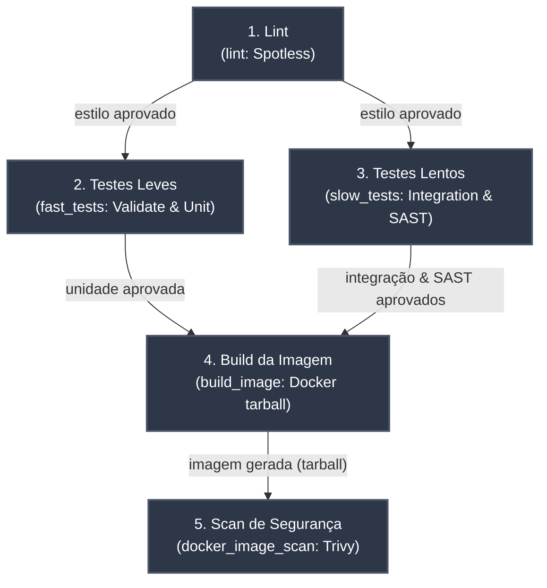

# Pipeline de Integração Contínua (CI)

O workflow em [.github/workflows/ci.yaml](../../.github/workflows/ci.yaml) implementa a esteira de Integração Contínua (CI) do projeto, automatizando desde a verificação do código-fonte até a análise de vulnerabilidades da imagem conteinerizada.

## Triggers

O pipeline é disparado automaticamente nos seguintes eventos:

| Evento | Condição |
|---|---|
| `push` | Branch `main` |
| `pull_request` | Branch `main` (target) |
| `workflow_dispatch` | Execução manual via GitHub Actions UI |

---

## Visão Geral do Grafo (DAG)

A esteira foi projetada como um Grafo Acíclico Dirigido (DAG), garantindo que etapas interdependentes executem em ordem estrita de pré-requisitos, enquanto etapas independentes executem em paralelo para minimizar o tempo total de execução (*lead time*).

---

## Estrutura dos Jobs

| Job | Identificador YAML | Dependências (`needs`) | Responsabilidade | Ferramentas / Comandos |
|---|---|---|---|---|
| **1. Lint** | `lint` | Nenhuma (raiz) | Verifica estilo e formatação do código-fonte. | `actions/checkout@v4`, `actions/setup-java@v4`, `./mvnw spotless:check` |
| **2. Testes Leves** | `fast_tests` | Nenhuma (paralelo ao `lint`) | Validação de estilo/formatação e testes unitários isolados. | `./mvnw validate` (Spotless, Checkstyle, Enforcer) e `./mvnw test` (Surefire) |
| **3. Testes Lentos** | `slow_tests` | Nenhuma (paralelo ao `lint`) | Testes de integração com banco real e análise estática (SAST). | `./mvnw verify -Dskip.unit.tests=true` (Testcontainers) e `./mvnw spotbugs:check` (SpotBugs) |
| **4. Build da Imagem** | `build_image` | `[fast_tests, slow_tests]` | Empacota a aplicação em imagem Docker e exporta como artefato `.tar`. | `docker/build-push-action@v5` (`push: false`, `outputs: type=docker`), `actions/upload-artifact@v4` |
| **5. Scan da Imagem** | `docker_image_scan` | `build_image` | Varredura de vulnerabilidades de SO e bibliotecas na imagem gerada. | `actions/download-artifact@v4`, `docker load`, `aquasecurity/trivy-action@master` |

---

## Por que Executar os Testes Rápidos e Lentos em Paralelo?

A separação entre `fast_tests` e `slow_tests` e sua execução concorrente traz benefícios cruciais para o ciclo de desenvolvimento:

1. **Redução Substancial do Tempo de Pipeline (*Wall-Clock Time*):**
   - Os testes rápidos (lint, formatação e testes unitários puros) executam em ~30 segundos.
   - Os testes lentos (SAST com análise profunda de bytecode e testes de integração subindo PostgreSQL via Testcontainers) levam de 1 a 2 minutos.
   - Em vez de somar os tempos (`30s + 90s = 120s`), o tempo de espera até o início do build é de apenas `max(30s, 90s) = 90s`.

2. **Feedback Rápido (*Fail-Fast*):**
   - Desenvolvedores recebem retorno imediato caso haja quebra de formatação de código (Spotless) ou falha em lógica unitária, sem precisar aguardar o provisionamento de containers Docker ou a varredura completa de SAST.

3. **Isolamento de Causa Raiz:**
   - Erros de padrão de código não poluem os logs de testes de banco de dados, facilitando a identificação imediata da natureza do problema no dashboard do GitHub Actions.

4. **Independência de Pré-requisitos:**
   - Nenhum dos dois grupos de testes produz insumos necessários ao outro; ambos necessitam unicamente do código-fonte.

---

## Isolamento de Artefatos e Segurança no Pipeline

1. **Reprodutibilidade Estrita da Imagem:**
   - O job `build_image` compila a imagem e a salva em `/tmp/server-image.tar`, enviado como artefato do GitHub Actions (`docker-image`).
   - O job `docker_image_scan` baixa **exatamente esse arquivo `.tar`** e o carrega via `docker load`, garantindo que a análise de segurança ocorra sobre os mesmos bytes gerados no build.
   - Não há reconstrução da imagem após o scan de segurança.

2. **Critério de Falha de Segurança (*Gatekeeper*):**
   - O Trivy está configurado com `exit-code: '1'` e `severity: 'CRITICAL,HIGH'`. Qualquer vulnerabilidade crítica ou alta descoberta bloqueia o pipeline imediatamente.
   - Vulnerabilidades sem correção disponível são ignoradas (`ignore-unfixed: true`), focando apenas em riscos acionáveis.

3. **Controle de Publicação:**
   - O pipeline atual não inclui um job de publicação (`publish`). A imagem é validada e escaneada, mas não é enviada para nenhum registry. A etapa de publicação pode ser adicionada como job subsequente ao `docker_image_scan`.
