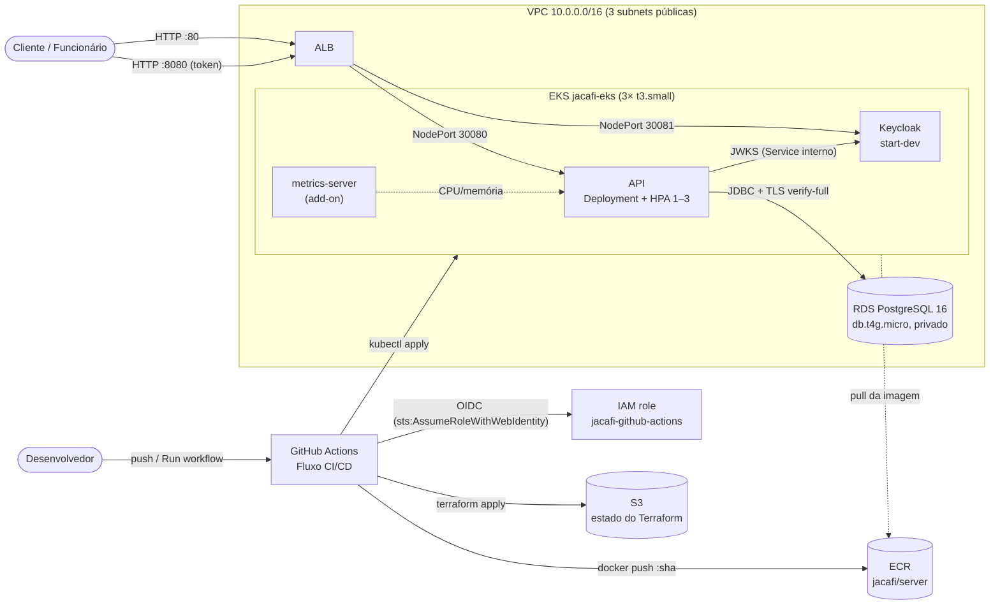
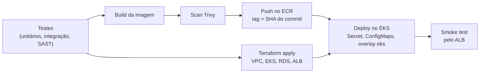

# Infraestrutura na AWS (Terraform)

A infraestrutura fica em dois stacks Terraform:

| Stack | Pasta | Quem aplica | Ciclo de vida |
|---|---|---|---|
| Bootstrap | `infra/bootstrap` | Você, uma vez, com credenciais de administrador | Persistente, com custo de centavos por mês |
| Ambiente | `infra` | O pipeline, via OIDC | Efêmero: sobe para trabalhar ou gravar e é destruído depois |

O ambiente é efêmero porque o EKS cobra US$ 0,10 por hora pelo plano de controle, mesmo sem nenhum pod rodando. Ligado o tempo todo, ele consumiria os US$ 100 de crédito em cerca de três semanas. Subindo só nas sessões de trabalho, 30 horas de uso custam aproximadamente US$ 7.

## Arquitetura



Fluxo de deploy (`.github/workflows/ci.yaml`):



## Recursos criados

### Bootstrap (`infra/bootstrap`)

| Recurso | Para quê | Custo |
|---|---|---|
| S3 `jacafi-tfstate-<conta>` | Estado do stack `infra`, com versionamento, criptografia e lock nativo (`use_lockfile`) | Centavos |
| Provedor OIDC `token.actions.githubusercontent.com` | Confiança da AWS nos tokens do GitHub Actions | — |
| IAM role `jacafi-github-actions` | Assumida apenas por workflows da branch `main` deste repositório. Usa `PowerUserAccess` e permissão IAM restrita a roles `jacafi-*`. | — |
| ECR `jacafi/server` | Imagens publicadas pelo pipeline; mantém as 10 mais recentes e faz scan no push | ~US$ 0,10 por GB/mês |
| AWS Budget `jacafi-mensal` | E-mail em 25%, 50%, 75% e 90% de US$ 100, medidos sem descontar créditos | — |

### Ambiente (`infra`)

| Recurso | Configuração | Custo aproximado (us-east-1) |
|---|---|---|
| VPC, 3 subnets públicas, internet gateway e rotas | `10.0.0.0/16`, sem NAT gateway | — |
| IAM roles `jacafi-eks-cluster` e `jacafi-eks-nodes` | Políticas gerenciadas do EKS, do CNI e de leitura do ECR | — |
| EKS `jacafi-eks` | Kubernetes 1.36 (suporte padrão até 08/2027), endpoint público, acesso por access entries | US$ 0,100/h |
| Node group | 3× `t3.small` AL2023, aceito nos planos Free e Paid da AWS | US$ 0,062/h |
| Add-on `metrics-server` | Métricas de CPU e memória para o HPA | — |
| RDS PostgreSQL 16 | `db.t4g.micro`, 20 GB gp3, privado, sem backup, aceita só o security group do cluster | US$ 0,018/h |
| Application Load Balancer | `:80` → API (NodePort 30080) e `:8080` → Keycloak (NodePort 30081) | US$ 0,023/h + LCU |
| IPs públicos IPv4 | 3 nós + ALB | US$ 0,030/h |
| Volumes dos nós | 3× 20 GB gp3 | US$ 0,007/h |
| **Total** | | **≈ US$ 0,24/h (≈ US$ 5,80 por dia ligado)** |

Os valores são de tabela, sem impostos. Confira na [AWS Pricing Calculator](https://calculator.aws/) antes de grandes mudanças de tamanho.

## Pré-requisitos

- **Conta AWS** no plano Free ou Paid. No Free, só alguns tipos de EC2 são aceitos; os tipos usados aqui (`t3.small` e `db.t4g.micro`) estão entre eles. A cota de vCPUs sob demanda precisa ser de pelo menos 6: confira em *Service Quotas → Amazon EC2 → Running On-Demand Standard instances*.
- **AWS CLI v2** autenticado com um usuário administrador. Ele só é usado no bootstrap.
- **Terraform ≥ 1.10.** O pipeline usa a 1.17.1.
- **Acesso de administrador ao repositório no GitHub**, para criar variables e secrets.
- **kubectl** (opcional), para acompanhar o cluster localmente.

## 1. Bootstrap (uma vez)

```bash
cd infra/bootstrap
cp terraform.tfvars.example terraform.tfvars   # informe o e-mail dos alertas
terraform init
terraform apply
terraform output
```

O estado do bootstrap fica local, em `infra/bootstrap/terraform.tfstate`, e é ignorado pelo Git. Guarde esse arquivo. Se ele se perder, os recursos continuam na AWS, mas precisam ser importados com `terraform import` antes de qualquer alteração.

Se a conta já tiver o provedor OIDC do GitHub, o `apply` falha por duplicidade. Nesse caso, importe-o antes:

```bash
terraform import aws_iam_openid_connect_provider.github \
  arn:aws:iam::<conta>:oidc-provider/token.actions.githubusercontent.com
```

## 2. Configurar o repositório no GitHub

Em *Settings → Secrets and variables → Actions*, crie:

| Tipo | Nome | Valor |
|---|---|---|
| Variable | `AWS_REGION` | `terraform output -raw aws_region` |
| Variable | `AWS_ROLE_ARN` | `terraform output -raw aws_role_arn` |
| Variable | `TF_STATE_BUCKET` | `terraform output -raw tf_state_bucket` |
| Variable | `ECR_REPOSITORY_URL` | `terraform output -raw ecr_repository_url` |
| Variable (opcional) | `EKS_ADMIN_PRINCIPAL_ARNS` | Lista JSON de ARNs IAM com acesso `kubectl`, ex.: `["arn:aws:iam::123456789012:user/voce"]`. Não inclua a role do pipeline, que já é administradora. |
| Variable (opcional) | `KEYCLOAK_ADMIN` | Usuário do console do Keycloak; padrão `admin` |
| Variable (opcional) | `RESEND_FROM` | Remetente dos e-mails de status, ex.: `JACAFI <no-reply@seu-dominio.com>`. O domínio precisa estar verificado no Resend e o valor não pode conter aspas. |
| Secret | `DB_PASSWORD` | Senha do RDS: 8 ou mais caracteres ASCII, sem `/`, `'`, `"`, `@` nem espaço |
| Secret | `KEYCLOAK_ADMIN_PASSWORD` | Senha do console do Keycloak |
| Secret (opcional) | `RESEND_API_KEY` | Chave do Resend. Junto com `RESEND_FROM`, liga os e-mails de mudança de status; sem os dois, os e-mails ficam desligados. |

Com o GitHub CLI, a partir de `infra/bootstrap`:

```bash
for name in aws_region aws_role_arn tf_state_bucket ecr_repository_url; do
  gh variable set "$(echo "$name" | tr a-z A-Z)" --body "$(terraform output -raw "$name")"
done
gh secret set DB_PASSWORD
gh secret set KEYCLOAK_ADMIN_PASSWORD
```

Enquanto `AWS_ROLE_ARN` estiver vazia, o pipeline roda só o CI e registra um aviso, sem falhar.

## 3. Subir o ambiente

Em *Actions → Fluxo CI/CD → Run workflow*, escolha a branch `main`. Na primeira vez, o pipeline leva cerca de 25 minutos:

1. Testes, build da imagem e scan com Trivy.
2. Push da imagem no ECR, com a tag igual ao SHA do commit.
3. `terraform apply` com VPC, EKS, RDS e ALB. Este é o deploy do banco de dados; as migrações Flyway rodam quando a API sobe.
4. Deploy no EKS: Secret, ConfigMaps e o overlay `k8s/overlays/eks`.
5. Smoke test pelo ALB.

O resumo da execução mostra os endereços da API e do Keycloak.

Enquanto o ambiente estiver no ar, cada push na `main` o atualiza: publica a nova imagem, roda `terraform apply` e aplica os manifestos. Com o ambiente desligado, o push só publica a imagem e não recria a infraestrutura.

## 4. Usar o ambiente

```bash
ALB=<alb_dns do resumo>
TOKEN=$(curl -s -X POST "http://$ALB:8080/realms/jacafi/protocol/openid-connect/token" \
  -d client_id=jacafi-web -d grant_type=password \
  -d username=dev-employee -d password=Dev-employee-2026 | jq -r .access_token)
curl -H "Authorization: Bearer $TOKEN" "http://$ALB/api/v1/customers"
```

Para usar `kubectl`, inclua seu ARN em `EKS_ADMIN_PRINCIPAL_ARNS` antes de subir o ambiente e rode:

```bash
aws eks update-kubeconfig --name jacafi-eks --region us-east-1
kubectl -n jacafi get pods,hpa
kubectl -n jacafi get hpa api --watch   # acompanhe durante o teste de carga
```

## 5. Derrubar o ambiente

- **Manual:** em *Actions → Derrubar ambiente AWS → Run workflow*, digite `DESTRUIR`.
- **Automático:** todo dia à meia-noite (horário de Brasília), como rede de segurança contra esquecimento. Se o ambiente já estiver desligado, o job termina sem fazer nada.

O destroy leva de 10 a 15 minutos e remove EKS, RDS, ALB e rede. **Os dados do banco não sobrevivem entre sessões.** O bootstrap continua intacto, com o bucket de estado, a role OIDC, o ECR e o orçamento.

Para remover tudo de vez:

1. Derrube o ambiente.
2. Esvazie o bucket de estado pelo console da S3 (*Empty*), o que remove também as versões antigas.
3. Rode `terraform destroy` em `infra/bootstrap`.

## Aplicar o stack `infra` manualmente

O caminho principal é o pipeline. Para aplicar a partir da sua máquina:

```bash
cd infra
terraform init -backend-config="bucket=<tf_state_bucket>" -backend-config="region=us-east-1"
export TF_VAR_db_password='<mesma senha do secret DB_PASSWORD>'
terraform apply
```

Quem cria o cluster recebe acesso de administrador automaticamente. Se o cluster for criado da sua máquina, inclua a role do pipeline em `cluster_admin_principal_arns`, ou o deploy pelo GitHub não terá acesso a ele. O deploy manual dos manifestos está descrito em [k8s/README.md](../k8s/README.md#aws-eks).

## Variáveis do stack `infra`

| Variável | Padrão | Descrição |
|---|---|---|
| `db_password` | — (obrigatória) | Senha do usuário master do RDS |
| `aws_region` | `us-east-1` | Região |
| `cluster_name` | `jacafi-eks` | Nome do cluster; o pipeline usa o mesmo valor |
| `kubernetes_version` | `1.36` | Versão do Kubernetes; mantenha uma versão em suporte padrão |
| `cluster_admin_principal_arns` | `[]` | ARNs IAM extras com acesso de administrador ao cluster |
| `node_instance_types` | `["t3.small"]` | Tipo dos nós |
| `node_desired_size` / `node_min_size` / `node_max_size` | `3` / `1` / `3` | Tamanho do node group |
| `db_instance_class` | `db.t4g.micro` | Classe do RDS |
| `db_name` / `db_username` | `jacafi` / `jacafi` | Banco e usuário master |
| `api_node_port` / `keycloak_node_port` | `30080` / `30081` | NodePorts expostos ao ALB; precisam bater com `k8s/overlays/eks/service-*.yaml` |
| `keycloak_listener_port` | `8080` | Porta pública do Keycloak no ALB |

## Segurança e limitações

- **HTTP sem TLS.** Não há domínio nem certificado, então os tokens trafegam sem criptografia entre o cliente e o ALB. Isso é aceitável para um ambiente de demonstração que existe só durante a sessão, mas não para produção.
- **Keycloak de desenvolvimento.** Ele roda em `start-dev`, com os usuários do realm versionado (senhas públicas no README) e o console administrativo exposto na porta 8080. Usuários criados pelo console somem quando o pod é recriado.
- **Senha do banco no estado.** Ela fica no state do Terraform, no S3 criptografado e acessível só pela conta.
- **Outbox com várias réplicas.** Os processadores agendados não coordenam entre réplicas ([k8s/README.md](../k8s/README.md#hpa-e-bloqueio-de-concorrência-da-outbox)). Para demonstrar o HPA, use carga de leitura.
- **RDS sem backup.** O banco é recriado vazio a cada subida do ambiente.
